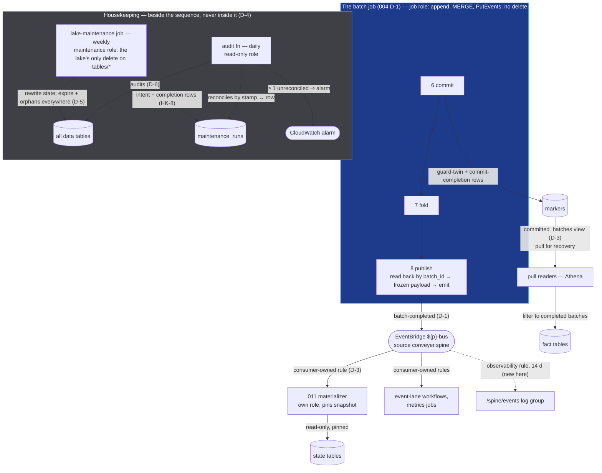

# Broadcast
## `publish` — and the Lane's Housekeeping — Architecture Description

**Status:** **Draft v0.2** (2026-09-13) — decision record proposed, D-1–D-8 drafted for review · **Draft history:** v0.1 — initial decision record (authored outside the repo), with a pre-handover engine/security check folded in — its three material findings are named in D-5 (b), HK-4, and D-6's operation mapping; **v0.2 — source-verification pass**: every citation checked against 004/004.1 + errata notes, 005/005.1, 006/006.1, 007/007.1 §16 (bead `conveyer-8fd`), the five ADRs, 001, 002.1, and the spine code and Terraform *as built* — 14 corrections and 4 additions, listed in §15 (no decision reversed; D-1 and D-6 each gained a clause) · nothing is settled until the house critique pass and the security gate (the maintenance role is a new delete-holding principal — [S-12]'s class; countersign per the `conveyer-hpp.6` security-gate pattern, 006.1 §16.8 [DS-4]) · **Parent:** *001 Batch Data Processing Architecture* (§2.5, §3.1, §3.3, §3.8, §5 row 8, §6) · **Plan:** 003 §3.5 · **Spine:** 004 §8–§9, §13 / 004.1 I-7, I-17, I-18, I-19, I-20, I-21, I-23, [T-9], [T-17], [T-18], [T-22], [S-2], [S-8], [S-12], §6.6, §7.1, §10.2–10.3, §11.4, §15.2 + errata notes §1 items 7, 8 (+ [ECX-1]), §2's 008 block, §3's bus-policy entry · **Record:** 007 D-5/D-6; 007.1 §4.3, §6.1–§6.5, §9, §11–§12, and §16's gathered 008 register (bead `conveyer-8fd`, the register-handoff bead — received in full, §3) · **Siblings:** 005/005.1 (admission tables enter maintenance scope), 006/006.1 (the perception contract; [DS-2]), 011 (the seam this doc opens), 012, 002.1 (the event-seam and maintenance-role precedents) · **Stack:** Glue 5.0 — Spark 3.5, **Iceberg 1.6.1** runtime (004.1 §7.1 / I-1; Terraform pins the runtime by `--datalake-formats iceberg` under `glue_version = "5.0"`, the version itself is pinned only in the local test jar, `spine/tests/conftest.py`) — every engine-behavior claim below is stated against that version and is re-confirmed by 008.1's kernel probes before it is coded (§12, §13 item 12) · **Position:** stage 8 — the boundary where a durable batch becomes broadcast novelty; and the lane's housekeeping, which runs *beside* the sequence, never inside it · **Pattern:** route / announce (003 §1); remember is upstream (005–007), move is the bus, housekeeping is a separate principal

> **Conventions.** Positions are recorded as decisions **D-n** in Y-statement form (004–007's convention: *in the context of… facing… we chose… and rejected… to achieve… accepting…*). Every received obligation is recorded in §3 and cited where it lands. Two label families are introduced because downstream docs will cite them: **BC-n** — the broadcast (consumer) contract clauses, stated in §7 — and **HK-n** — the housekeeping invariants, stated in D-5/D-6 and cited beside §8.1's duty table; both are settled with the decision that states them. Detail belonging to an LLD (008.1, when implementation starts — 003 §1) or to another cluster doc is named and deferred, not sketched. v1 will mean *reviewed and binding*, not final — friction from 008.1, 011, and 012 lands as v1.x revisions with decision-record updates (003 §3's expect-revisions-from-friction; the errata convention of 004.1 §15.3). Where this doc names a mechanism the repo does not yet contain (a view, a role, a rule, a table property), it says so — *new here* — rather than letting a proposal read as a description.

---

## 1. Context — From a Durable Batch to Broadcast Novelty

**The problem.** 007 ends with a batch that is durably *true*: its facts appended under one commit per table, its commit-completion marker row written, its folds merged. Nothing yet says how the rest of the world learns that — or, more precisely, what a consumer is *entitled to assume* when it learns it. Iceberg makes committed facts physically visible the moment commit lands (004 D-5), so the announcement cannot pretend to reveal anything; what it does is **make coherence available**: a consumer that waits for `batch-completed` may read the tables as a batch-coherent whole, and one that does not gets no promise (004 §9). This doc states that promise precisely (D-2), freezes the value that carries it (D-1), and decides how consumers subscribe and how the ones that cannot hold a subscription learn what is complete (D-3).

The second half of the doc is the part of the lane nobody announces. Iceberg tables accumulate snapshots, superseded files, delete files, orphaned writes from killed jobs — storage garbage, the normal consequence of never erasing (the value-of-values trade, priced up front). Somebody must collect it, and that somebody must hold a delete verb that *no other principal in the lane may hold* (001 §3.1 — stated there as Lake Formation grants, deployed as IAM plus bucket policy under 002.1 D-9's deferral; 004.1 [S-12]; 007 D-6). Every earlier doc handed this cluster a row of its register (§3): what to compact, what never to touch, how long snapshots live, which audits watch the writers. 003 §3.5 lists it as "catalog stats, compaction, snapshot expiration — cadence vs. the replay window promised in 001 §3.3"; by the time the register arrived here the shape had changed — [T-9]'s clustering discipline **dissolved structurally** on every `identity(batch_id)` table (005.1 A-8; ADR-OQ6; 007.1 §6.4), leaving state-table compaction as the one constitutive rewrite duty (007 D-5), a marker table under a retention *prohibition* (ADR-OQ2 N-4), and a 30-day snapshot horizon that the earlier docs assume and none pins on a data table. This doc pins it (D-5), makes every rewrite a stamped and recorded fact (D-5/D-6), and puts the two registered audits under a principal that is never the one it audits (D-6).

The stakes, stated once: **the announcement is the only coherence a consumer will ever get, and housekeeping is the only principal that can ever delete.** Get the first wrong and consumers read half a batch through a fired event; get the second wrong and the append-only law of 001 §3.1 rests on a role that was "just compacting."

### 1.1 The shape at a glance



**Legend.** Solid edges into tables are writes; the only rewrite in the picture is the maintenance job's, on state tables only, and it is stamped and recorded before it is trusted. Dotted edges are observability. The bus carries values, never references: nothing on `batch-completed` names a snapshot (D-1; `batch-started`'s `land_snapshot_id` is §13's open item). Three principals, three verb sets: the job role appends/merges/emits; the maintenance role deletes and rewrites and announces nothing; the audit role reads. The 004 §1.1 legend is not copied here (004.1 errata item 19: `post_check` is declared data, the fold is framework-owned).

---

## 2. Scope & Non-Goals

**The problem.** This cluster is two things that must not become one: an *announcement* the whole lane's coherence contract rests on, and a *program* that holds the lane's only delete. A doc that let the second leak into the first — a stage that "also compacts," an event that "also reports" — would complect the consumer gate with operations. So the scope is drawn as two jobs with one owner, and the non-goals are mostly the seams between them.

**In scope:** the frozen `batch-completed` payload and its evolution rule (D-1); the consumer gating contract — promises and non-promises, per table class (D-2, §7); subscription mechanics, the pull-side completed-batch surface, and the reserved marker accretions (D-3); publish's exact effect set and the 001 §5 re-aim (D-4); the maintenance program — duties by table class, the snapshot horizon and the three promises it bounds, cadence, engine, roles, the maintenance record (D-5, §8); the two scheduled audits and their reconciliation rule (D-6); the rebuild and maintenance runbooks as register rows, the alarm thresholds this doc owns, re-emission, `attributable=False` threading (D-7); the seam to cross-materialization (D-8).

**Deferred:** procedure parameters, DDL for `maintenance_runs` and the `committed_batches` view, the audit's predicates as code, alarm wiring, runbook prose, the scenario suite (008.1); `RebuildCompletedV1`'s shape and the emit-only run mode (the event 007.1 §16 registers as a *proposed* 004.1 erratum row — not yet in 004.1; this doc adds a ruling on its shape, D-7); the rebuild entrypoint's **deployment surface** (`spine/spine/entrypoints/rebuild_main.py` has no Glue job yet — bead `conveyer-swb.31` F-2; this doc states what that job's name and run history must satisfy, D-5 (c) / D-6 (ii), and builds nothing); what 011 materializes, keyed how, and its own staleness record (011); the quarantine queue and marker projections for remediation (012); quarantine-row retention and the erasure posture (`conveyer-4ot.41`, Track B); table-level statistics for the analytical spoke and the first execution of the cardinality review (013); the `pipeline.yaml` surface — **009 owes this doc nothing**: housekeeping is invisible to pipeline authors (001 §6) and the event carries no per-pipeline routing (D-8).

**Not reopened:** 004.1's `BatchStartedV1` (settled; one note in §13); 007.1's marker mechanics (consumed as-is — this doc adds a *reader*, never a writer); ADR-OQ6's no-rewrite stance on fact tables (PS-1 — consumed, with its "a rewrite needs a decision record" clause honored as HK-1).

---

## 3. Received Obligations (recorded, per the handing docs' instruction)

This doc receives the registers of 003 §3.5, 004 §9/§13.1, 004.1 §15.2 and errata-notes §2, 005 §6.2/§13.6 and 005.1 §4.3/§15.2, 006.1 §16.7, 007.1 §16 (the gathered 008 rows, v0.4–v0.5.4 — bead `conveyer-8fd`), and the five ADRs. Each row lands in a decision or a section; none is silently absorbed.

| From | Obligation | Lands |
|---|---|---|
| 003 §3.5 (1) | `batch-completed` payload — counts (rows in, facts emitted, quarantined); schema governed with the event backbone | D-1, §6 |
| 003 §3.5 (2) | Consumer gating contract — what "you may now read batch N" means precisely; how consumers subscribe | D-2, D-3, §7 |
| 003 §3.5 (3) | Catalog stats, compaction, snapshot expiration — cadence vs. the replay window promised in 001 §3.3 | D-4 (stats), D-5, §8 |
| 003 §3.5 (4) | The trigger seam to 011 — publish announces; it does not materialize | D-8 |
| 001 §5 row 8 / §6 | Publish "emit `batch-completed` with counts…; update catalog stats; trigger compaction if thresholds hit"; §6: "framework-scheduled compaction + snapshot expiration — invisible to pipeline authors"; cross-materialization "triggered by `batch-completed`" | D-4 (re-aimed, erratum note §12), D-5, D-8 |
| 001 §3.3 | Time travel yields "state as of" *any* table snapshot | D-5 (bounded by the horizon — erratum note §12) |
| 001 §6 erratum (ADR-OQ6) | Additive partition-spec evolution reserved under 008's cardinality review | D-5, §8.3 |
| 004 §9; 004.1 §15.2 (008 row, 4th obligation) | Payload owned by 008; "consumers needing as-of reads use the snapshot ids carried in `batch-completed`"; pull-based readers must filter to completed batches — "the mechanics of knowing which batches are complete belong to 008" | D-1 (ids dropped; as-of re-homed — erratum note §12), D-2, D-3 |
| 004 §13.1 | The lifecycle events are the consumer gate, *not* an observability channel | D-1 (payload discipline), D-4 (stuck-batch detection stays I-18's) |
| 004 §8 / 004.1 I-7, [T-17], I-18 | Emission unconditional on every attempt, at-least-once, dedup on `batch_id`; any failed `PutEvents` entry raises `TransientError`; execution `SUCCEEDED` ⟹ emitted — re-check if publish leaves the job or `emit` stops raising | D-4 (dependency restated) |
| 004.1 I-19, §6.6, R-02, R-09, E-1 | Payloads describe the batch, not the attempt — durable read-backs; [H-1] `started_at`/`completed_at` are the declared attempt-truth exceptions; R-02's field-equality tripwire (errata item 7 added `state_snapshot_id` as a third exception); R-09's zero counts; the rerun is *the* announcer; `fact_count` ≠ `facts_appended` (one identifier, one sourcing) | D-1 |
| 004.1 §7.1 / I-1 | Glue 5.0 — Spark 3.5, Python 3.11, Iceberg 1.6.1 runtime | Status ("Stack"), D-5, D-6, 008.1 probes (§12), §13 item 12 |
| 004.1 errata #7 | Drop `state_snapshot_id` at freeze (a third attempt-truth exception otherwise) | D-1 — dropped |
| 004.1 errata [ECX-1] | `fact_snapshot_id` is `None` for zero *or more than one* fact table; `fact_count` answers "were there facts" | D-1 — dropped; `fact_count` is the field |
| 004.1 errata #8 / 007 D-5 | `attributable=False` threading — whether/how, since it is WARNING-only today | D-7 (ledger, additive) |
| 004.1 §15.2 [T-9]; errata §2 | Compaction must preserve `batch_id` clustering on fact tables (carried forward unchanged) | **Discharged by others**, recorded: dissolved on admission tables (005.1 A-8, §4.3), fact + marker tables (ADR-OQ6 / 007.1 §6.4); residual = state-table sort restoration (007 D-5) → D-5, HK-1 |
| 004.1 §10.3 / §15.2 [S-12]; 007 D-6 | The compaction role's delete grant is a new narrow IAM exception — never a pipeline-job grant; maintenance's delete isolated to 008's role | D-5 (roles), HK-10 |
| 004.1 I-4, §9, [T-22]; 005.1 §15.2; 007.1 §9.1/§11/§12/§16 | Orphan-file sweep — killed writes (abort cleanup logs delete-denied noise), admission tables, refused rebuild swaps | D-5, HK-4 |
| 004.1 I-17, [T-18] | The run ledger is maintained by ingestion's Athena Lambda (`OPTIMIZE` + `VACUUM`, weekly); the ledger's own `write.metadata.delete-after-commit.enabled` / `previous-versions-max` pair is scoped to that one table | §8.1 (run-ledger row, out of scope), D-5 (b) (the pair does not generalize — erratum note §12), §13 item 1 |
| 005 §6.1, §6.2, §13.6; 005.1 A-8, §4.3, §15.2 | `raw_count` = all extractable rows, flagged included = count of `valid_df` + `pre_quarantined` (freeze-time note); [T-9] extended to raw/quarantine (§6.2) then discharged structurally (A-8); admission tables into maintenance scope (orphan sweep); one partition per batch — review cardinality at real cadence; quarantine retention decided with `conveyer-4ot.41`, never as a bare length (§13.6 — also the only source of raw's "indefinite, same as facts" default) | D-1 (`raw_count`), D-5, §8.1 (raw + quarantine rows), §8.3, §12 (012 / Track B) |
| 006.1 §16.7 [DS-2]; 007.1 F-10 / §6.5 step 6 | Maintenance must preserve `conveyer.table-class` through rewrites; 008's role is an expected writer of job-role-mutable metadata; the class-property drift audit treats 008's rewrites as expected and alarms on any other writer | D-5 (HK-6), D-6 |
| 007 D-5 | Merge-on-read shifts cost to readers between compactions — cadence registered here | D-5 |
| 007.1 §16 [maintenance] (gathered) | One merged cardinality review (admission + fact + marker); fact compaction near-moot — residual = review + "optional within-partition merges"; state sort restoration constitutive; marker retention **prohibition** (N-4 — `horizon-exceeded` handling ships first); fold-row / as-of home reserved (additive row kinds, `conveyer-nvh.40` not reopened); snapshot expiration bounds as-of (§9.5); `spine-delta-refusals-30d` as an Athena named-query candidate | D-3 (reservation), D-5, HK-1/HK-5, §8.3, §13 |
| 007.1 §16 [DS2-1] | The snapshot-operation audit: facts + marker alarm on any op ≠ append; state on any op outside {the fold's MERGE, the rebuild-window overwrite}; 008's own rewrites reconciled against its scheduled runs, never allowlisted by operation class — "the exact summary-string mapping is the build epic's mechanics; the policy is this row's" | D-6 (the mapping is stated here as *policy* so the predicates can be specified at all; the engine confirmation is 008.1 probe (4)), HK-8, HK-12 |
| 007.1 §16 [F-7 / RB-3]; ADR-OQ7 | Rebuild runbook with the quiesce probe's blind window stated in substance ([AE2-6], §9.2); `RebuildSwapRetries` threshold (shape only — consecutive refusals; re-derive on the swap-as-MERGE fallback); refused-swap orphans (§9.1, §11, §12); trigger governance (I-20 class, §9.4); interim manual re-materialization until `RebuildCompletedV1` lands (§9.3) | D-7 |
| 007.1 §9.3 / §11 / §16 | `RebuildCompletedV1` — the proposed 004.1 erratum row; 011 and 008's runbook are its named consumers; "the runbook's re-emit step (008)" (the §11 kill row) | D-7 (re-emission is a run), D-8 |
| 007.1 §6.3 | Marker `snapshot_id` NULL on every Phase-1 row so 008's accretion is additive; "008's registered readers union across pipelines under their own role" | D-3 |
| 007.1 §16 [F-3 / [PB-1]] | Fact-layout review: review-with-real-data, no hard trigger; watch the far-back-correction knob; PS-2's re-argument input | §8.3 |
| ADR-OQ1 | "008 co-owns the consuming mechanics" (decision owners) and "008 inherits its completed-batch surface instead of inventing one" (consequences) | D-3 |
| ADR-OQ5 L-1, L-2, Option D / L-3, L-4 | Batch-truth only in markers; fold rows reserved as additive row kinds — "008's registered as-of question"; completion stage-scoped by name, marker-first write order; delivery attributes (`delivery_key`, `delivery_content_hash`, `received_at`) ride every marker row; ledger evolution additive-only | D-1 (`received_at`), D-3, D-5 (d) (the write order, applied to housekeeping), D-7 (d) |
| ADR-OQ6 PS-1, PS-2 | Evolution owned by 008's review; the no-rewrite stance is a *choice* — a data-justified rewrite needs a decision record; append-locality is load-bearing for any evolved spec | D-5, HK-1, §8.3 |
| 002.1 §6.4, D-9, D-14; 004 D-13; 004.1 I-16, §12.5 | Envelope (`${p}-bus`, `source`, `DetailType`, `Detail` = model JSON); at-least-once with `batch_id` dedup; the single maintenance role holding delete on `ledger/*` (and, as built, `spine/run_ledger/*`); contracts as golden JSON fixtures with contract tests on both sides; additive-only, new version = new file | D-1, D-3, D-5 (roles) |

---

## 4. Information Model

**The problem.** Before a payload is frozen or a compaction scheduled, the information has to be named — because the two halves of this doc handle *different kinds* of thing, and most of the design pressure comes from confusing them.

**The facts.** A batch's completion is **not a new fact**. Everything true about batch N was recorded before publish runs: its facts (fact tables), its rows (raw, quarantine), its commit-completion (the marker row — batch-truth, L-1), its attempts (the run ledger — attempt-truth). Publish *derives* an announcement from those durable values and *moves* it. The one genuinely new fact this cluster produces is housekeeping's: **"maintenance run R rewrote table T from snapshot A to snapshot B"** — a thing that happened, with lineage, that nothing else in the lane records and that the audit needs as ground truth (D-5's maintenance record).

**The identities.** Every conveyer table (a succession of snapshots behind a catalog pointer — 004 §4). Maintenance is the only principal *permitted* to create a non-append snapshot on any conveyer table — and on fact, raw, quarantine, and marker tables D-5 says it never does; the audit exists for anyone else (D-6). The bus is **not** an identity: it holds no state, remembers nothing, and is deliberately not asked to (D-3 rejects the archive). The batch is a value named `batch_id`, minted upstream (004 §4) — the announcement names it and carries no reference to anything mutable.

**The perceptions.** Three, each with its own surface and its own guarantee:

- **Event-driven consumers** perceive at batch granularity through `batch-completed`: coherence by gating, "at least N" (D-2). This is broadcast novelty in the reified-process sense — push, never poll.
- **Pull readers** (Athena analysts, a recovering materializer) perceive through the tables directly. For facts, the completed-batch surface (D-3's view over the marker tables) says which `batch_id`s are safe to read. For state, every snapshot is a committed-fold boundary (006 D-2's mechanics; D-3 clause 2) — per-table coherence needs no gate; *batch attribution* of a state snapshot is what pull readers lack, and D-3 reserves its home.
- **Operators** perceive the process through the three channels of 004 §13 — and, new here, the maintenance record and the audits' alarms. The announcement is never an operator surface (004 §13.1).

Two things this model rules out before any decision is written: the event carrying a *reference* (a snapshot id is a name for a value that maintenance will eventually expire — a permalink that quietly stops resolving); and housekeeping *announcing* (a rewrite preserves every value; a consumer that could observe it would be observing a place, not a value).

---

## 5. Decision Record

Eight decisions, each in Y-statement form. The *accepting* clauses are gathered again in §11 for the skim reader. D-1–D-3 are the announcement; D-4 is the seam between the two halves; D-5–D-6 are housekeeping; D-7 is the runbook and alarm register; D-8 is the seam to 011.

### D-1 — The frozen payload: identity, lineage, four counts, one data-borne ordering key; no snapshot ids; `completed_at` stays the single declared attempt-truth exception — **proposed**

In the context of freezing `BatchCompletedV1` (003 §3.5; 004.1 §6.6's provisional shape, marked there for this doc), facing errata #7 (`state_snapshot_id` is attempt-truth — a no-op rerun reports `None`; and the MERGE is the unstamped commit class, errata §2's 007 row / `conveyer-nvh.40`, so no rerun can re-derive it) and [ECX-1] (`fact_snapshot_id`'s `None` now means "zero *or more than one* fact table produced a snapshot" — a field whose nullity carries three meanings and answers no consumer's question), **we chose**: the payload is **identity + lineage + counts + one data-borne ordering key** — `pipeline`, `feed_id`, `batch_id`, `delivery_id`; `received_at` (the delivery's `received_at` — the seed's value, which 007.1 §6.3 denormalizes onto every marker row under ADR-OQ5 Option D / L-3 and which the marker's ordering read keys on: max `(received_at, batch_id)` per feed, ADR-OQ1 M-2 / 007.1 §4.3 — **read back by publish from N's commit-completion marker row**, the durable row BC-4 already rests on, so the event and the completed-batch view (D-3) are keyed from one row by construction); `raw_count` (flagged rows included, 005 §6.1), `pre_quarantined`, `post_quarantined`, `fact_count` (durable read-back summed over every declared fact table — *the* field that answers "were there facts", [ECX-1]); and `completed_at` (attempt-truth, declared [H-1], informational) — with **both snapshot-id fields dropped**. Every non-timestamp field is durable-derived (I-19), so a rerun's re-emission is field-identical except `completed_at`: R-02's tripwire, which errata #7 had grown to three exceptions, regains a single one. The promise 004 §9 attached to the ids — as-of reads — is re-homed, not dropped: a consumer pins the snapshot it reads at receipt, and that snapshot contains N (D-2, BC-2); the *exact* batch→snapshot home stays the reserved marker accretion (D-3) — **and rejected** per-table snapshot maps (fact ids are lineage with a 30-day shelf life and no consumer: reading N's facts is a partition read under `identity(batch_id)`, no snapshot needed; state ids are attempt-truth, and a map of them makes the contract's exception set grow with the number of tables a pipeline declares), **and rejected** per-table counts, declared-table lists, or any attempt-truth "for debugging" (the events are the consumer gate, not an observability channel — 004 §13.1; the run ledger is the report, and a payload that reports is a payload ops will one day mutate), **and rejected** `delivery_key` / `object_uris` on the bus (partner-derived, [S-8]-classified — every subscriber's log group would inherit the classification; `delivery_id` is the join key for anyone who needs the ledger), **to achieve** an event that is a *value naming what happened* — small enough that a consumer's entire contract test is one fixture, identical across reruns by construction, and free of fields whose meaning depends on how many tables a pipeline declares — **accepting that** consumers receive no snapshot id from the event and pin their own; and that the `v1` freeze *removes* two fields from the provisional model — possible only because the contract has no subscriber yet (nothing consumes `batch-completed` before 011, Phase 4): the last non-additive change this contract will ever see, stated as a rule for Track A — **a lifecycle contract freezes at its first subscriber, not at its first emission** — where "subscriber" has the one observable proxy a producer that never knows its subscribers (D-3) can see: the first consumer fixture test **outside the producing package** (004.1 I-16's consumer side). The spine's own `spine/tests/contracts/test_parse_fixtures.py` parses `batch-completed/v1-basic.json` today — that is the producer's round-trip check, not a subscriber; the observability log rule is not a subscriber either.

**Mechanics settled with it:**

- **Why the marker row, when the seed carries the same value.** Every attempt starts from the same seed (a `--rN` run is a fresh execution over the same `delivery-registered` input, 004 D-10), so `received_at` is attempt-stable either way; the marker read-back is chosen for uniformity of I-19's rule — every non-timestamp payload field is a *durable read-back of this lane's own records*, never an input — and because BC-4 rests on that same row. L-3 makes the two sources agree by construction; publish therefore **asserts** `seed.received_at == marker.received_at` and fails the attempt on disagreement — an L-3 incoherence is a write defect to surface, never a value to choose between (*v0.2 addition*).
- **Producer/consumer asymmetry.** The producer model carries `extra="forbid"`. 004.1 §6.6's provisional text declared no `model_config` on either lifecycle model; the build applied the spec-model idiom (004.1 §6.2) to both (`spine/spine/core/model.py`; the exported schema has `additionalProperties: false`) — the freeze **ratifies** that as the contract's rule rather than introducing it. Every consumer parses with `extra="allow"` — the tolerant-reader idiom of 004.1 §6.1 — so additive evolution never breaks a subscriber. A new `schema_version` is a new fixture file, never an edit (004.1 §12.5). One gap closes at freeze: `spine/tests/unit/test_model.py` rejects an extra field on `BatchStartedV1` only — the frozen model gets the same test (008.1).
- **The fixture becomes normative.** `contracts/fixtures/events/batch-completed/v1-basic.json` is rewritten to the frozen shape — the one-time non-additive edit named above, recorded in §12 — and thereafter governs both sides: the spine's producer test asserts exact JSON (`spine/tests/contracts/test_emit_fixtures.py` — its `_PINNED_COMPLETED` moves with the fixture), the spine's own parse test re-parses it, and 011's consumer test parses it (004 D-13's both-sides discipline). Track A inherits it as a machine-checked example.
- **Additive candidates, named so nobody invents them twice:** `supersedes_batch_id` — the seed's field once `conveyer-kof` lands (ADR-OQ2), carried with N-3's caveat (absence means *unknown*, never "no supersession"). Nothing else is foreseen; a proposed field must show a consumer that cannot read the tables instead.
- **Count identities.** `raw_count = |valid| + pre_quarantined` (005 §6.1) holds on the wire; no identity relates `fact_count` to `raw_count` — `apply` may fan out or collapse. Zero-fact and all-quarantined batches announce with zero counts (R-09) — `fact_count = 0` is the wire form; `batch_check`-failed batches never reach publish (006.1 §11: "no facts ever", the batch stays failed on every retry — an inference from the stage order, since 006.1 does not say "publish") — so an *absent* event is a failed or stuck execution (I-18), never a quiet batch.
- **004 §9 erratum — a capability narrowed, and labelled as such** (into `conveyer-ti0`'s pass): 004 promised consumers an exact handle — "the snapshot ids carried in `batch-completed`"; this doc withdraws it for an upper bound — "pin at receipt; the pinned snapshot contains N (*at least* N); batch-exact as-of is the reserved marker accretion (D-3)". Within the payload mandate 004 delegated, and half-argued already by errata #7/[ECX-1] — but a consumer reading 004 v1.1 would design against a promise 008 has narrowed, so the note says *narrowed*, never "no decision reversed".

### D-2 — The gating contract: promises and non-promises per table class; the load-bearing clause is *at least N*, never *exactly N*; as-of by pinning at receipt — **proposed**

In the context of stating what "you may now read batch N" means (003 §3.5; 004 §9), facing Iceberg's visibility of committed facts before the fold (004 D-5), parallel same-feed siblings (004 D-12), and the completed-but-unfolded window's standing consequence (007.1 §11 [AE2-2]), **we chose** a contract of five promises and six non-promises stated per table class (§7, BC-1…BC-11) whose load-bearing clause is **"at least N"**: on receipt of `batch-completed` for N, every declared fact table holds N's facts entire, every declared state table's current snapshot includes N's fold, and a snapshot the consumer pins at-or-after receipt keeps both properties for as long as it exists — 006 D-3's clauses 2–3, generalized from `apply` to every consumer — **and rejected** promising "exactly N" (the pinned state may already contain later siblings' folds; only `serialize: true` closes that ceiling, and only for the pipeline's own perception — 006 D-3 clause 3 — never a consumer's), **and rejected** hiding mid-batch facts behind a branch, a view, or a "published" flag on rows (the comfortable fiction 004 D-5 already refused; Iceberg branches would make every table a two-pointer identity and every reader a branch-aware reader — perception complected with process), **and rejected** promising that N's *delivery content* is reflected in state (drop-safety compares facts, never state — 007 D-2: a fired event can hold a pre-predecessor value for keys a successor lawfully dropped as unchanged against a predecessor whose fold has not yet rerun; bounded by SFN retry, alarmed by I-18, but *standing* — stated here as BC-7 so no consumer discovers it), **to achieve** a contract a consumer can hold in one sentence and test with one pinned read, **accepting that** batch-exact perception — "state as of exactly N" — is not available in Phase 1 (the pinned snapshot bounds it above; nothing bounds it below until D-3's reserved rows land), and that ungated readers keep getting no guarantee (004 D-5, unchanged).

### D-3 — Subscription is push for liveness and pull for recovery; the marker tables are the completed-batch surface, exposed as a classification-safe view (new here); fold/publish row kinds stay reserved with 011 as the named trigger — **proposed**

In the context of how consumers subscribe and how readers who cannot hold a subscription learn which batches are complete (003 §3.5; 004 §9's deferred mechanics; ADR-OQ1's "008 inherits its completed-batch surface instead of inventing one"), facing EventBridge's at-least-once, unordered delivery and consumers that will sometimes be down, **we chose**: (a) **event-driven consumers subscribe with their own EventBridge rule on `${p}-bus`** — `{source: ["conveyer.spine"], detail-type: ["batch-completed"], detail: {pipeline: [...]}}` — owned by the *consumer's* IaC (the bus is the platform's; the rule is the subscriber's; the producer never knows its subscribers), deduplicating on `batch_id` and ordering completions by `(received_at, batch_id)` — the marker's ordering read (M-2; 007.1 §4.3) applied to the bus: one ordering rule, two surfaces; (b) **recovery is pull**: a consumer that missed events reads the completed-batch surface — the marker tables' commit-completion rows — through **one view, `<spine db>.committed_batches`** (*new here* — 007.1 defines no view; its `committed_tables(batch_id)`, §4.3, is a different derived read, the per-batch set of committed fact tables, and the two names must not be confused), named for the stage whose completion it reports (ADR-OQ5 L-2: completion is stage-scoped by name; "completed" unqualified is the event's word, and it means more), **owned by the deploy principal and placed outside every `<slug>__*` grant** (a view is a Glue table whose SQL is catalog metadata; under I-21's per-pipeline `glue:UpdateTable` on `<slug>__*` a job role could redefine a `<slug>__`-named view — job-role-mutable metadata, F-10's premise — so it lives in the spine database and its definition joins the drift audit's asserted set, D-6), unioning every pipeline's `<lake db>.<slug>__markers` rows with `stage = 'commit'` and `table_name = '-completion-'` (007.1 §6.3's sentinel) under the reader role 007.1 §6.3 anticipates ("008's registered readers union across pipelines under their own role") and projecting exactly `pipeline, feed_id, batch_id, received_at, committed_at` — where `pipeline` is a **per-branch literal** (the marker table carries no pipeline column; each union branch names its own slug) — and **never** `delivery_key` / `delivery_content_hash` (007.1 [DS2-3]'s classification discipline); stated honestly: without Lake Formation (deferred, 002.1 D-9) a view is a *door*, not a wall — a reader needs `glue:GetTable` on the marker tables and S3 read on their locations to use it, so the boundary is the **reader role's grant set** (that role is therefore [S-8]-classified until Track B brings column grants), and a Spark or pyiceberg reader (011 recovering) reads the marker tables directly under the same role and applies the same projection in code — the discipline travels with the role, not with the SQL; and the view answers *complete*, never *current* — without `delivery_key` it cannot collapse superseded re-deliveries, which is the ledger's job today and `supersedes_batch_id`'s on the event tomorrow; (c) **fold-completion and publish-completion row kinds stay reserved** (ADR-OQ5 L-2's additive accretion; Phase 1 writes none), with **011's staleness contract — "current as of batch N" — named as the activation trigger**: the first consumer that needs batch-exact as-of pays the design, against a real need, instead of this doc guessing the row shape — **and rejected** an EventBridge archive with replay as the recovery path (a second durable record of completions, on the bus — the queue's job is moving; remembering already has a home in the marker table, and an archive that lags or truncates would be a completed-batch surface with two truths), **and rejected** activating a publish-completion row now (a durable "announced" that duplicates the orchestrator's execution truth — I-18: `SUCCEEDED` ⟹ emitted — and the ledger's publish row, for pull readers who need *commit*-completion, not announcement), **and rejected** the spine emitting per-consumer or per-target events (routing belongs in rules), **to achieve** one push surface and one pull surface, each with one job, and completed-batch mechanics that reuse an artifact three ADRs already pay for, **accepting that** pull-based recovery lands on commit-completion, so a recovering consumer can read a batch whose fold is still pending (the [AE2-2] window — bounded by the lane's own retry; BC-7 applies to it exactly as to the event), and that fold-exact as-of waits on 011.

**Mechanics settled with it:**

- **Phase-1 observability rule** on the bus (*new here* — no rule matches `source = conveyer.spine` today; the only observability rule is ingestion's, `{source: ["conveyer.ingestion"]}` → `/conveyer/${env}/ingestion/events`, 14 d, 002.1 §10.5): `{source: ["conveyer.spine"]}` → log group `/conveyer/${env}/spine/events` (14 d) — the 003 phase gate's "`batch-completed` out" becomes observable end-to-end before 011 exists (today the smoke test reads the run ledger's publish row instead, a named gap in `spine/tests/smoke/test_smoke.py`). Registered as a 004.1 §10.2 addition (§12).
- **The view is a reader, never a writer.** It adds no principal to the marker tables' write side; 007.1's mechanics are consumed untouched. DDL and the reader role are 008.1's.
- **The reservation, stated so it cannot drift:** when activated, fold rows are `(batch_id, 'fold', state_table)` under L-2's stage-scoped naming, carrying a snapshot *at-or-after* the fold's MERGE as **`(snapshot_id, sequence_number)`** — the v2 table's monotone sequence number is what expresses "at-or-after" (snapshot ids are random longs; a lineage relation cannot be read off them) and it stays meaningful after the snapshot itself has expired; additive on 007.1 §6.3's schema. Durable-derivable on any attempt — the current snapshot after a no-op rerun still contains N — where the exact MERGE snapshot is not (the unstamped-MERGE gap, accepted at 007 D-5). An upper bound written honestly beats an exact id that a rerun cannot reproduce. Whether that bound is tight enough for 011 is 011's question.

### D-4 — Publish does one thing: derive the announcement from durable state and emit it; housekeeping is a separate scheduled principal, never a stage effect; "catalog stats" is not a Phase-1 duty — **proposed**

In the context of 001 §5 row 8 ("emit `batch-completed` with counts…; update catalog stats; trigger compaction if thresholds hit") and 003 §3.5 (3), facing the job role's append-only law (no delete verb on any pipeline principal — 004.1 [S-12]; 007 D-6; as built, `spine/terraform/modules/spine-pipeline/iam.tf` grants `s3:GetObject`/`PutObject` only, with the lake bucket policy's `DenyDeleteExceptMaintenance` as the resource-side wall) and the reduction that makes stuck batches detectable (004.1 I-18: publish runs *inside* the job and `emit` raises, so execution `SUCCEEDED` ⟹ emitted), **we chose** publish = **one pure derivation plus one effect** — read back the counts and `received_at` by `batch_id` (I-19), build the frozen payload (D-1), `fx.emit`, accrete `published` and `completed_event` (the two fields `BatchContext` already reserves) — and **housekeeping as a separate scheduled Glue job under its own role** (D-5), invisible to pipeline authors (001 §6) and to consumers (a rewrite changes no value and announces nothing — §4), **and rejected** compaction or statistics triggered from publish (either a delete verb lands on a job role, or the last stage of every batch calls out across roles — the batch's success complected with housekeeping's, and I-18's reduction re-argued for nothing), **and rejected** "catalog stats" as a duty at all in Phase 1 (every pruning path in the lane rides file-level column stats that Iceberg writes on every append — guard probes, `read_batch`, delta reads, PS-1's analytical pruning; table-level NDV/Puffin statistics serve join planning in the analytical spoke and are deferred to 013's measured need, where a real query pays for them), **and rejected** publish writing a marker row (D-3), **to achieve** a publish stage whose failure modes are exactly `emit`'s (I-7, [T-17]) and whose rerun is *the* announcer (E-1), plus a 001 §5 erratum note that re-aims row 8 (§12), **accepting that** the lane gains one scheduled principal to operate, and that a state table needing compaction between weekly runs pays read cost, never correctness (007 D-5's accepted trade, now with a cadence).

**Dependencies restated as this doc's own:** publish stays inside the job; `emit` keeps raising `TransientError` on any failed entry (`spine/spine/effects/events.py`); stuck-batch detection stays the orchestrator's (`ExecutionsFailed` / `ExecutionsTimedOut`, 004.1 §11.4) — **no alarm is ever built from a `batch-started` / `batch-completed` pair** (004 §13.1's two-audiences rule, confirmed: the gate events are not an observability channel, and an event-pair alarm would make consumer-contract fields load-bearing for ops).

### D-5 — The maintenance program: duties by table class; one 30-day snapshot horizon held in the maintenance job's own configuration; weekly Spark procedures under one narrow role named outside the spine's job glob; every rewrite stamped and marker-first recorded; lake versioning re-decided — **proposed**

In the context of compaction, snapshot expiration, orphan cleanup, and the replay window (003 §3.5 (3); 001 §3.3/§6; 007.1 §16's gathered register), facing tables whose duties genuinely differ by class — [T-9] dissolved structurally on every `identity(batch_id)` table (005.1 A-8; ADR-OQ6; 007.1 §6.4), merge-on-read state tables whose delete files and decayed sort order are *constitutive* compaction duty (007 D-5's accepted trade; the "table-metadata instruction to a job that must run anyway" of 007.1 F-3/§6.4), a marker table under a retention prohibition (ADR-OQ2 N-4), and a 30-day snapshot horizon that the earlier docs assume (004.1 I-3, I-19, [E-9]; 007.1 §9.5; ADR-OQ5's "30-day snapshot-summary decay"; pinned only for the ledger tables, 002.1 §9.4 / 004.1 I-17) and none pins on any data table — and facing a repo in which **no data-table maintenance exists at all today** (the only maintenance principal is ingestion's `${p}-maintenance` Lambda — Athena `OPTIMIZE … REWRITE DATA USING BIN_PACK` + `VACUUM` on the ledger tables, weekly, with `s3:DeleteObject` on `ledger/*` and `spine/run_ledger/*`; nothing touches `tables/*`) — **we chose**:

(a) **Duties per class** (§8.1's table). Raw, quarantine, fact, and marker tables receive **expire-snapshots and remove-orphans only — never a data-file rewrite**; the register's "optional within-partition merges" on fact tables (007.1 §16 [maintenance]) is **declined and recorded**: a `replace` on a fact table is the audit's strictest-class alarm (D-6), and the one case where bin-pack would matter — a backfill batch writing hundreds of small files into one partition — is priced at read time by that partition's one-partition scan and becomes a PS-1 decision record if 013 measures it, never a schedule entry. State tables receive, weekly, **in this order**: rewrite data files in the declared sort order (007.1 §6.2's sort order on `domain_id_col`) with `delete-file-threshold` set low enough that any data file carrying position deletes is selected — Iceberg 1.6.1's default threshold is `Integer.MAX_VALUE`, so a well-sized file accumulating deletes week after week would otherwise *never* be rewritten and the duty 007 D-5 calls constitutive would be nominal; then rewrite position-delete files — with default options, this step, not the data rewrite, is what removes deletes made dangling by the data rewrite, so data-first is load-bearing (1.6's `remove-dangling-deletes` option on the data rewrite is the alternative; probe (1) settles which form the job uses); then rewrite manifests; then expire and orphans. `partial-progress` stays off (one rewrite = one commit — the grain the record in (d) assumes). The run ledger stays with ingestion's Athena Lambda (004.1 I-17 — untouched).

(b) **One horizon, every data table, every class: 30 days, minimum 5 snapshots — held in the maintenance job's own configuration and passed explicitly to every expiry call.** Deletion policy is never read from table properties: a job role holds `glue:UpdateTable` on its own tables, and F-10's premise applies — job-role-mutable metadata is provenance, never protection — so a horizon read from the table would let the audited principal set the policy the trusted principal executes. The `history.expire.*` properties are still set (*new here* — no data table carries them today), as *informational* declarations for Athena and pyiceberg readers, asserted-and-repaired by the maintenance job under one-owner-per-property (HK-6) and included in the drift audit's asserted set (D-6). `write.metadata.previous-versions-max = 20` bounds the metadata log. **`write.metadata.delete-after-commit.enabled` is set on no job-role-written table** — the pair exists today on exactly one table, the run ledger (`spine/spine/effects/ledger.py`; 004.1 I-17 [T-18]), and must not be generalized: under the lane's delete-deny, Iceberg 1.6.1's Spark commit path attempts the old-metadata deletion *after* the catalog pointer has moved and, through S3FileIO's bulk delete, raises on the denied keys — every commit past the log bound would fail *after succeeding*, and the guard-skipping rerun would die on its next effect (a 004.1 [T-18] erratum, §12: the run ledger's pair is written by pyiceberg, which logs a failed metadata delete and continues — a silent no-op under the deny, not a fault; the mechanism does not carry over to Spark-written tables; probe (2) confirms both halves). Stale `metadata.json` files beyond the log are orphans by Iceberg's own reachability definition and the weekly orphan removal collects them. Belt and braces: **`s3.delete-enabled = false` on every job-role catalog configuration** (*new here* — no catalog configuration in the repo sets it; `spine-pipeline/main.tf`'s `iceberg_conf` carries extensions and the Glue catalog only), so the job path never issues a delete API call at all — which also silences [T-22]'s abort-cleanup noise. The horizon **ratifies** what the earlier docs assumed and bounds three promises at once, stated in §8.2.

(c) **Weekly, Spark procedures, one Glue job `${p}-lake-maintenance`** — named *outside* the `${p}-spine-*` glob on purpose: `spine-sfn` holds `glue:StartJobRun` on `job/${p}-spine-*` (004.1 §10.3; `spine-platform/main.tf`), and starting a job is code execution as its role (I-23) — the lake's only delete-holder must not be startable by the orchestrator, nor collide with a pipeline slugged `maintenance`. The `StartJobRun` **Allow** on it is the Scheduler role's alone; and because Glue jobs carry no resource policy of their own, the boundary is stated honestly as three things — the name outside the glob, the Scheduler-only Allow, and an **explicit identity-policy Deny** on `glue:StartJobRun` for `job/${p}-lake-maintenance` carried by every spine-platform role (`spine-sfn`, the router, every job role, the operator role) as belt-and-braces — with the standing residual that a principal holding an unscoped `glue:StartJobRun *` (an account administrator) is outside it, the same residual the bus policy carries (D-7 c). `max_concurrent_runs = 1` (the lane's single-writer principle applied to housekeeping — an overlapping weekly run would race on the same tables and double-record). Tables come from the **platform-level inventory union** (*new here*): today each deploy writes a per-pipeline `table-classes.json` beside its spec (`spine/spine/bootstrap/create_record_tables.py`; `naming.table_class_inventory_uri`; consumed by bind through `glue_main._load_table_class_inventory`) — the deploy aggregates those into one content-pinned artifact under `${p}-artifacts/spine/inventory/`, never a catalog listing (HK-7). The role holds the lake's only delete on `${p}-lake/tables/*`, plus `Get/Put/List` there, `glue:GetDatabase/GetTable/UpdateTable` on the lake database's tables and on `<spine db>.maintenance_runs` (its own record — a commit needs `UpdateTable`), and `s3:Put*` on `spine/maintenance_runs/*`: [S-12]'s narrow exception — narrow in holders (one) and prefix (one), cross-pipeline by necessity — and, stated plainly because 002.1 D-9's precedent could only erase an ops ledger, **a full logical write-and-erase capability over the fact tables**. That is why (e) exists.

(d) **A maintenance record, marker-first.** The table `<spine db>.maintenance_runs` lives under `${p}-lake/spine/maintenance_runs/` — *not* under `tables/*`, so the maintenance role cannot erase its own record; the prefix rides I-17's split (appended by the maintenance role, pruned by ingestion's Athena Lambda under its `vacuum_*` table properties, with the maintenance Lambda's delete grant extended by that one prefix). One **intent row** `(run_id, table, operation, before_snapshot_id, outcome = started)` is written *before* each rewrite and one **completion row** after — ADR-OQ5 L-2's write order applied to housekeeping — and every rewrite snapshot is **stamped** `conveyer.maintenance-run-id = run_id` through the action API's snapshot-property surface (`spark._jvm` → `SparkActions…rewriteDataFiles(...).snapshotProperty(...)`; the SQL `CALL` surface cannot pass it — a 008.1 kernel probe confirms the plumbing, and if it fails the fallback is attribution by window ∧ operation class, priced as weaker in D-6). Reconciliation is **two-sided — stamp ↔ intent row** — so a rogue rewrite would have to forge both a snapshot property *and* a row in a table no job role can write; a crash between a rewrite's commit and its completion row is **self-healing** (the next run derives the completion row from the stamp), and no human-attestation path exists.

(e) **Bucket versioning on `${p}-lake`, re-decided.** 002.1 §10.2 chose "Versioning off (Iceberg manages its own history)" when delete covered only `ledger/*`; as built, the bucket simply has no versioning resource. With a principal that can delete fact files, every maintenance deletion becomes reversible for **35 days** (a noncurrent-version expiration longer than the 30-day horizon, applied bucket-wide to noncurrent versions only), and S3's version history is a record the maintenance role cannot forge — the non-forgeable corroboration D-6 leans on, together with **CloudTrail data events** (*new here* — none exist) on `tables/*` object deletes and on `glue:UpdateTable` for the lake and spine databases. The cost is bounded by this doc's own invariants: fact, marker, raw, and quarantine files are never rewritten (HK-1) and expiry deletes none of them (HK-3), so noncurrent versions arise only from state rewrites, orphan sweeps, and — on the same bucket — the ledger tables' own weekly `VACUUM` deletions, which the rule now also retains for 35 days.

**And rejected** the Glue Data Catalog's managed table optimizers for Phase 1 (rewrites on the optimizer's own cadence — a third concurrent-writer class on state tables at moments the rebuild runbook cannot schedule around; reconciliation through a second API surface and identity, with no stamp of ours on the snapshot; merge-on-read delete-file handling unstated in its documentation; re-evaluable at 013 with measured cost — its per-table opt-in makes the exclusion of fact and marker tables natural if that door ever opens), **and rejected** extending ingestion's Athena maintenance Lambda to data tables (no sort restoration, no orphan removal, and Athena `VACUUM` ignoring `history.expire.*` — 002.1 §9.4's own recorded trap), **and rejected** recording maintenance runs in the run ledger, or by a self-stamped snapshot property *alone*, or by the job's run window (the ledger is job-role-writable and lossy by design, ADR-OQ5 L-1; a stamp alone is what any job role's tooling can also produce; a window is coarse and Glue's run history is neither lake-resident nor queryable beside the record — the intent row is the half a suspect cannot forge), **and rejected** reading the horizon from table properties (F-10's premise), **and rejected** per-pipeline maintenance knobs in `pipeline.yaml` (invisible to authors, 001 §6 — 009 owes nothing), **and rejected** continuous or per-batch compaction (a rewrite after every fold interleaves with sibling folds on busy feeds and makes the conflict source unschedulable), **to achieve** housekeeping that is a value-preserving, role-isolated, scheduled program whose every rewrite is a stamped, marker-first-recorded fact, and a replay window stated honestly — **facts: unbounded, by rebuild; state perception: 30 days** — **accepting that** as-of perception older than 30 days is not available from state tables (the fact-side re-fold at N's pins that 007.1 §9.5 names is the path, unbuilt); that maintenance rewrites are a conflict source for concurrent folds — *file-scoped*: a fold and a rewrite touching disjoint files both commit, and when they touch the same files one of the two refuses (I-11 retry — efficiency, never correctness, the F-3/[T-10] class; the runbook places the window off feed peaks, §9); that the lane now has **two** delete-holding principals, both maintenance-class and prefix-disjoint (`ledger/*` + `spine/run_ledger/*` + `spine/maintenance_runs/*` vs `tables/*` — 002.1 §10.2's single `DenyDeleteExceptMaintenance` statement becomes two prefix-scoped statements, §12); that the maintenance role's capability over facts is real and is answered by versioning, CloudTrail, and the audits rather than by a smaller grant (no smaller grant compacts a state table); that versioning stores 35 days of replaced state files, swept orphans, and vacuumed ledger files; and that the horizon is uniform where a per-class argument could be made (a longer state-table window buys as-of history at the cost of every replaced file and delete file for that long — 013's data can revisit it, HK-2).

**The invariants this decision states (HK-1…HK-10, binding; §8 cites them beside the duty table):**

- **HK-1 — No rewrite on append-only classes.** Fact, marker, raw, and quarantine tables receive no data-file rewrite from maintenance, ever — the register's optional within-partition merges are declined (D-5 a); a data-justified fact rewrite is a PS-1 decision record, never a schedule change.
- **HK-2 — The horizon is uniform, floored, and held by the maintenance job.** 30 d / min 5, passed explicitly to every expiry call; table properties are declarations, never deletion policy. Changing either number is a decision-record change that must keep audit cadence ≪ horizon (HK-11) and must re-argue the stamped-summary window I-19 assumes.
- **HK-3 — Expiry on an append-only class deletes zero data files.** Every snapshot on these classes is an append — raw: one per batch; quarantine: one per writing stage; marker: at most N+1 per batch (a zero-novel type writes no guard-twin row, 007.1 §6.3) — and an append never unreferences a data file, so every data file stays referenced by the current snapshot. Manifests and manifest lists *are* removed by expiry (normal). The alarm keys on the procedure's deleted-data-file count only; ≥ 1 is **a rewrite's fingerprint** (D-6).
- **HK-4 — Orphan removal never deletes an in-flight write's file — a correctness invariant with a non-convergent failure mode.** Iceberg appends verify nothing on S3: a file swept while its attempt is still writing and then committed yields a snapshot with a dangling reference — a partition every guard probe and every reader fails on, with no rerun that can re-append it and no repair outside the rewrite class HK-1 forbids. Therefore `older_than` ≥ max(3 d, 2 × the longest budget of any run that writes under `tables/*` — batch attempts *and* rebuilds, which carry no `sla_minutes`), derived by the maintenance job from the deployed platform maximum and refusing to run when it cannot be derived; `prefix_mismatch_mode` pinned; table locations asserted non-nested before any sweep.
- **HK-5 — The marker table is never pruned** (N-4, restated as a prohibition this program obeys): no row deletion, no rewrite; expiry is metadata-only by HK-3. Any future horizon ships `horizon-exceeded` handling *first*.
- **HK-6 — Properties survive maintenance, and each has exactly one owner.** Bootstrap owns `conveyer.table-class`, `write.merge.mode`, `write.merge.isolation-level` (007.1 §6.5 step 3 [DC2-3]), and the declared sort order; maintenance owns `history.expire.*` and `write.metadata.previous-versions-max`. Each principal asserts its own set before and after its runs and repairs only its own; the drift audit checks the union (D-6). Two principals repairing one property would flap.
- **HK-7 — Discovery is the inventory union, never the catalog — and the audit enumerates the catalog.** A table absent from the union is not maintained; a table present in the lake or spine database and absent from the union is an audit finding (D-6), never a silence.
- **HK-8 — Every rewrite is marker-first recorded and stamped:** intent row before, `conveyer.maintenance-run-id` on the commit, completion row after. A stamp without a row, or a row without a stamp, alarms (D-6).
- **HK-9 — No S3 lifecycle rule touches *current* objects under `${p}-lake/tables/*`** — neither expiration nor storage-class transition: Iceberg expects synchronously readable files at object-store latency, so a transition is a slow or unreadable snapshot and an expiration a corrupt one; (e)'s rule acts on noncurrent versions only. 002 §12's Glacier allowance is for landing objects only.
- **HK-10 — The maintenance role announces nothing and reaches nothing else:** no `events:PutEvents`, no landing or ledger prefixes, no cross-lane grant; `StartJobRun` on `${p}-lake-maintenance` is Allowed to the Scheduler role alone and explicitly Denied to every spine-platform role (D-5 c).

### D-6 — Two scheduled audits under a read-only principal that is never the one it audits; the operation-string mapping stated as policy; reconciliation two-sided; the threat model named — **proposed**

In the context of the class-property drift audit (006.1 §16.7 [DS-2]; 007.1 F-10 / §6.5 step 6) and the snapshot-operation audit (007.1 §16 [DS2-1]), facing a residual IAM cannot close — the **own-writer logical rewrite**: a job role's `glue:UpdateTable` + `s3:PutObject` suffice to commit a rewrite snapshot on its own tables (007.1 §6.1; ADR-OQ1 M-1's [DS2-1] annotation) — and facing the fact that 007.1 stated its policy in terms of a "MERGE" operation that Iceberg's summaries do not carry and assigned "the exact summary-string mapping" to the build epic's mechanics, **we chose** one scheduled audit function, **daily**, `${p}-lake-audit` (a container-image Lambda: `pyiceberg` over each table's current `metadata.json` — the snapshot list with summaries — plus `glue:GetTable`/`GetTables`, the inventory union, and `maintenance_runs`; a metadata read needs no Spark), under a **read-only role distinct from the maintenance role** (the auditor is never the audited) whose S3 read on data tables is scoped to `…/metadata/*.metadata.json` — manifests carry column bounds of classified columns and the audit never reads them — and which reads **one table in full**: `maintenance_runs`, the record it reconciles against (spine-owned, no partner-derived column); with the following predicates, and **the summary-string mapping stated here as policy** — because the predicates cannot be specified without it — and confirmed against the running engine by 008.1 probe (4) before it is coded (Iceberg 1.6.1, as read from its source: an append → `append`; a row delta — the fold's merge-on-read MERGE, and any merge-on-read `UPDATE`/`DELETE` that writes delete files — → `overwrite` with **no removed data files**; a metadata-only delete → `delete`; every rewrite action → `replace`; the rebuild's full overwrite → `overwrite` with **removed data files**, where the first overwrite of an *empty* table may surface as `append` — probe (4) decides, and predicate (ii) reconciles either form):

(i) **Append-only classes (fact, marker, raw, quarantine):** alarm on any snapshot whose operation is not `append`; and — because the string is writer-asserted — alarm on any non-monotone file set along the lineage (`total-data-files` or `total-records` decreasing; any `deleted-data-files` / `removed-*` key present), a predicate no label choice defeats.

(ii) **State:** `replace` must reconcile **two-sided** — the snapshot's `conveyer.maintenance-run-id` stamp matches an intent row in `maintenance_runs` for that table (HK-8); `overwrite` with removed data files is the **full-overwrite class** (the rebuild swap, 007.1 §9.2) — reconcile to a run of the rebuild job in its Glue run history, a source no job role can write (no job role holds `glue:StartJobRun`, 004.1 §10.3), until 004.1's registered rebuild stage vocabulary lands in a non-lossy form and takes over — and, stated honestly, the rebuild entrypoint has **no deployment surface yet** (`conveyer-swb.31` F-2), so until it lands no deployed rebuild can occur and every full-overwrite snapshot alarms unconditionally; `overwrite` without removed data files is the **row-delta class** — the fold — with the residual named: a rogue merge-on-read `UPDATE`/`DELETE` is indistinguishable by summary and is held at [DC2-2]'s linter/effects boundary, not here; `delete` alarms; `append` alarms unless reconciled to a first rebuild of an empty table.

(iii) **History — two predicates plus one** (*v0.2 addition*): (a) alarm on a snapshot whose parent id is absent from the table and was never observed (a gap), and on an observed snapshot id that vanishes before the horizon without a matching expiry row in `maintenance_runs` (the audit keeps its own observed-id set outside the lake) — the two predicates that catch the expire-to-hide move: expiry is a metadata commit any job role can perform on its own tables, and only the file deletion is denied; (b) **current-pointer regression**: alarm when a table's current snapshot is not a descendant of, or equal to, the last observed current snapshot — the signature of `rollback_to_snapshot`, `set_current_snapshot`, and cherry-pick, metadata-only commits that leave every file in place, rewrite perception, and create no new operation string; without (b) the move is visible only when expiry later deletes the abandoned snapshot's files and HK-3's fingerprint fires, up to a horizon late.

(iv) **Class-property drift:** catalog properties versus the inventory union, over the union of HK-6's owned sets (`history.expire.*` and `write.metadata.*` included — they are audit inputs now). The audit observes *values*: Glue records no writer, so 006.1 §16.7's "expected writers" clause is enforced by value and corroborated by CloudTrail `UpdateTable` events (D-5 e), not by the catalog.

(v) **HK-3's fingerprint**, reported by the maintenance run; and **catalog completeness** (HK-7): any table in the lake or spine database absent from the inventory union.

**Threat model, stated so D-5's rejections stay consistent:** the audits are the detection layer for **honest-but-buggy writers** — a library default, a misconfigured job, an engineer's "quick rewrite" or "quick rollback" run with the job's own tooling. A **hostile** own-writer — one that forges a `metadata.json` or expires history to hide a rewrite — is held at I-21's authored-code/CI boundary and by the non-forgeable records D-5 (e) adds (CloudTrail; S3 version history); predicates (i) and (iii) raise the cost of hostility but do not claim to bound it. This is why a self-stamped property is rejected as a *sole* source (the honest-but-buggy writer's tooling can stamp too) and the intent row is required (it cannot write one).

**And rejected** allowlisting by operation class (with the mapping stated, "state tables may `overwrite`" would admit both the fold *and* a rogue `UPDATE` — the split by removed data files is the narrowest honest predicate), **and rejected** reconciling by the maintenance job's run window (coarse — a rogue rewrite timed inside a published quiet window passes), **and rejected** folding the audit into the maintenance job (same principal, no separation — the record it would check is its own), **and rejected** an audit that reads manifests (classification), **to achieve** a detection layer whose soundness rests on three things — the intent row is written by a role the job roles cannot assume, every snapshot is observed before expiry can remove it, and the predicates are stated against the strings Iceberg actually writes — **accepting that** detection is after the fact (a rewrite is visible the next morning, not prevented); that the row-delta residual is real and held at another boundary; that a hostile principal is outside the audits' scope by declaration; that rebuild reconciliation rides Glue run history — a bounded-retention source the daily audit only ever needs yesterday of — until 004.1's accretion lands; that a parse failure (an unknown operation string) is an alarm, never a crash; and one more scheduled function to operate.

**The invariants this decision states (HK-11…HK-13, binding):**

- **HK-11 — Audit cadence ≪ snapshot horizon.** Daily against 30 d / min 5 gives every snapshot on the order of thirty observations before it can expire; any change to either side keeps at least twenty.
- **HK-12 — Reconciliation is two-sided and by identity, never by class or clock.** Maintenance rewrites: stamp ↔ intent row. Rebuilds: full-overwrite snapshot ↔ rebuild job run. Everything unmatched alarms regardless of its operation string or its timing.
- **HK-13 — The audit holds no write verb** on any lake prefix, catalog table, or bus; on data tables it reads only `metadata/*.metadata.json` — no manifest, no data file; the one table it reads in full is its own reconciliation record, `maintenance_runs`, plus the inventory union artifact.

### D-7 — Runbooks and alarms as register rows: the rebuild runbook with its blind window, `RebuildSwapRetries` at five, re-emission is always a governed run, `attributable=False` threads into the ledger — **proposed**

In the context of the efficiency-classed rebuild runbook ADR-OQ7 assigned here (RB-3), the alarm shape 007.1 §12 registers (no numbers — the threshold is this doc's), the "re-emit step (008)" 007.1 §11 names, and the `attributable=False` threading errata #8 leaves to this doc, **we chose**: (a) **the rebuild runbook** (policy here; prose in 008.1) — the rebuild is a run mode (007 D-5; 007.1 §9.4: a separate entrypoint, `spine/spine/entrypoints/rebuild_main.py`, under the pipeline's own job role, no `--force` flag by construction — RB-2) invoked only through a governed trigger of I-20's operator-run class; and, stated honestly, in Phase 1 the operator role's `states:StartExecution` + `DescribeExecution` on the spine state machines (`SpineOperatorStartExecution`, the env root; a role that exists with **no one** in its assume list by default) is the whole control for `--rN` runs, while the rebuild entrypoint has **no deployment surface yet** (`conveyer-swb.31` F-2) — when it lands, whoever holds `glue:StartJobRun` on that job *is* the trigger (never a job role; I-23), so "governed" means *named and runbooked*, not *second-party-approved*; the [DS-4] approver pattern for out-of-band rebuilds is a security-gate option recorded in §13, not claimed here; on a busy feed run the marker in-flight probe first (presence without commit-completion) **with the blind window stated verbatim, never optional** (007.1 §9.2 RB-3 [AE2-6]): *marker presence begins at the first guard-twin write, mid-commit; a batch anywhere in land→apply is invisible to the probe; a clean probe is not "quiet," only "no batch at-or-past its first marker write"*; and schedule the rebuild off the maintenance window (D-5's rewrites are a second conflict source for the swap's conditional commit, RB-2); (b) **`RebuildSwapRetries` alarms at five consecutive refusals within one invocation** — each refusal is a full recompute plus a refused commit plus orphan files (007.1 §9.1), so five is where "no quiet window exists" becomes the diagnosis rather than bad luck; priced under the replace shape, **re-derived if the swap-as-MERGE fallback is ever adopted** (ADR-OQ7 validation 1); (c) **re-emission is always a job-role run that derives the announcement from durable state** — for a batch, a rerun (`{batch_id}--rN`, 004 D-10; the rerun *is* the announcer, E-1); for an out-of-band rebuild, the run mode's **emit-only path**, shipping with `RebuildCompletedV1` under 007.1 §16's proposed 004.1 erratum row — and that row should apply **D-1's rule to the event's shape**: 007.1 §9.3's working shape carries per-state-table post-swap snapshot ids, which are references on the bus (§4); the honest shape is `pipeline`, `occurred_at`, and a rebuild run id as informational attempt-truth, with 011 pinning at receipt (the pinned snapshot is at-or-after the swap) and treating *every* `rebuild-completed` as a fresh instruction to re-materialize, idempotent under repeats — it has no batch and therefore no dedup key — **no operator, console, or script ever calls `PutEvents`**: the bus resource policy's explicit **Deny** statements — `DenyForgedIngestionSource`, `DenyForgedSpineSource`, `DenyUnknownSource` (`spine/terraform/modules/spine-platform/events.tf`; added over the original allow-only policy in 004.1 errata §3's bug ledger, `conveyer-nvh.41` [F2]) — are what make a hand-emitted spine event unconstructible for every same-account principal that is not a producer role (an allow-only resource policy restricts nobody who holds an identity grant), and this doc elevates those Denies to load-bearing (§12), with the standing residual that an account administrator can edit the policy; until `RebuildCompletedV1` lands, the interim manual re-materialization step stays in the runbook, named as discipline (007.1 §9.3); (d) **`attributable=False` threads into the run ledger** as an additive boolean on the fold stage's row (ADR-OQ5 L-4; a 004.1 erratum) with a standing query `spine-unattributable-merges-30d` — never into the event (batch truth only, D-1), never read by correctness (007 D-5) — **and rejected** a manual emitter (forging the lane's own announcements from outside the derivation that makes them true — the [S-2] policy would have to be weakened to permit it), **and rejected** leaving attribution WARNING-only (a residual that cannot be counted cannot be priced), **and rejected** any operational lock for rebuilds (ADR-OQ7 Option B, already rejected — restated so the runbook never grows one: pausing a rule or a state machine is discipline one level up, and the forgotten re-enable is a silently stopped lane), **to achieve** runbooks whose every step is a governed run or a read, and residuals that are countable, **accepting that** an emit-only re-announce is new run-mode mechanics (registered to 004.1 with the event, §12), and that five consecutive refusals is a threshold set before real feed cadence exists — revisited with 013's data.

### D-8 — The 011 seam is the frozen event plus read-only tables, nothing else; the batch is complete at announcement, never at materialization — **proposed**

In the context of the trigger seam to cross-materialization (003 §3.5 (4), §6; 001 §6 "triggered by `batch-completed`"), facing the pull toward "just push to Mongo from publish — it's one call" and toward target lists in the event, **we chose**: the seam is **the frozen event (D-1) plus read-only grants on the declared state tables** — 011 subscribes by its own rule (D-3), runs under its own role, pins the snapshot it reads (BC-2: it contains N — so its staleness contract is "current as of at-or-after N," by construction), keeps its own record of `batch_id → snapshot materialized` (its truth, on its side), re-materializes on `rebuild-completed` (replace semantics — this doc's ruling over the event 007.1 §9.3 requires), and dedups on `batch_id`; its **change surface** is the lane's own idiom, never something the lane must add: the domains N touched are derivable from N's fact partition (BC-1 — the fold's `touched` set at consumer grain), and the pinned state rows for those domains are a correct upper bound of the delta under *at least N* (a sibling's change in the same domain is included, which BC-6 already permits) — a full re-scan per event is the alternative 011 may choose; and 011 discovers a pipeline's declared state tables and `domain_id_col` from the deployed spec and the inventory union, never from the catalog (HK-7's rule applies to consumers); **the batch is complete at announcement** — 011's failure never fails, delays, or re-announces a batch — **and rejected** publish calling out to any materializer (a synchronous dependency from the lane's last stage to an external store: the batch's completion complected with MongoDB's availability, and a second write capability on the job role), **and rejected** materialization targets or flags in the event (the producer would know its subscribers — routing belongs in rules; 011's inventory is 011's declaration, placed by 009/011, never by this doc), **and rejected** an outbox or a "materialized" completion row on the spine's side (011's record is 011's; a marker row kind for it would put a consumer's state in the lane's batch-truth table), **to achieve** a seam 011 can be designed against without touching this lane — the event fixture and the state tables' schemas are its entire input — **accepting that** 003 §6's "failures block or trail the batch" resolves as *trail*: a consumer can be behind, and its staleness is its own alarm.

*(Decision record proposed for v0.2; new decisions enter as D-9… if the critique pass or 011's drafting reopens ground.)*

---

## 6. The Frozen Payload (D-1, drafted)

**The problem.** A payload is a contract the moment something parses it. The provisional model has carried three fields whose meaning drifted under N tables; the freeze must leave only fields whose meaning is fixed by the batch, not by the attempt or the pipeline's shape.

```python
class BatchCompletedV1(BaseModel):             # DetailType "batch-completed"; source conveyer.spine — FROZEN (008 D-1)
    model_config = ConfigDict(extra="forbid")  # producer side — already on the built model; ratified at freeze (D-1);
                                               #   consumers parse with extra="allow"
    schema_version: Literal[1] = 1
    pipeline: str; feed_id: str; batch_id: str; delivery_id: str   # identity + lineage (seed values)
    received_at: AwareDatetime                 # read back from N's commit-completion marker row — the data-borne
                                               #   ordering key (M-2; 007.1 §4.3): order completions per feed by
                                               #   (received_at, batch_id), never by arrival or clock;
                                               #   publish asserts it equals the seed's value (L-3 coherence)
    raw_count: int                             # durable read-back; flagged rows included (005 §6.1)
    pre_quarantined: int                       # durable read-back by (batch_id, check_stage = 'pre_check')
    post_quarantined: int                      # durable read-back by (batch_id, check_stage = 'post_check')
    fact_count: int                            # durable read-back, summed over every declared fact table;
                                               #   0 announces a zero-fact batch (R-09). NOT facts_appended [H-1]
    completed_at: AwareDatetime                # the ONE attempt-truth field [H-1] — informational; R-02 excludes it
```

| Field | Sourcing | Rerun-stable? | Why it is here |
|---|---|---|---|
| `schema_version` | constant | yes | Evolution rule: additive within 1; a new integer is a new fixture file |
| `pipeline`, `feed_id`, `batch_id`, `delivery_id` | seed (`delivery-registered`) | yes | Identity and lineage; `batch_id` is the dedup key (BC-5); `delivery_id` joins the ledger for anyone who needs `delivery_key` (never on the bus, [S-8]) |
| `received_at` | durable read-back from the commit-completion marker row (the seed's value, denormalized there — ADR-OQ5 Option D / L-3; 007.1 §6.3), asserted equal to the seed's | yes | The ordering key consumers need to say "latest *seen* completed batch of feed F" from events alone — the same key, from the same row, the marker's ordering read and the `committed_batches` view use (007.1 §4.3); one rule, one source, two surfaces |
| `raw_count`, `pre_quarantined`, `post_quarantined`, `fact_count` | durable read-backs (I-19; `spine/spine/stages/publish.py`) | yes | 001 §5's counts, as batch truth; `fact_count = 0` is a real announcement, not an absence |
| `completed_at` | `fx.now()` | **no** — declared [H-1] | Informational; never gate, order, or dedup on it |
| ~~`fact_snapshot_id`~~, ~~`state_snapshot_id`~~ | — | — | **Dropped** (D-1): attempt-truth or three-valued; as-of is by pinning (BC-2, BC-9) |

**Envelope** (unchanged from 004.1 §5/§7.6, cited): `PutEvents` to `${p}-bus`, `Source = "conveyer.spine"`, `DetailType = "batch-completed"`, `Detail` = the model's JSON; the bus resource policy's explicit Deny statements restrict `events:source` to the producer roles ([S-2]; 004.1 errata §3's fix — load-bearing for D-7); any failed entry raises `TransientError` ([T-17]). The fixture `contracts/fixtures/events/batch-completed/v1-basic.json` is rewritten to this shape and is the normative artifact from then on — the same change moves `_PINNED_COMPLETED` in `spine/tests/contracts/test_emit_fixtures.py` and re-runs `spine/tests/contracts/test_parse_fixtures.py`, and adds the `BatchCompletedV1` extra-field rejection test `spine/tests/unit/test_model.py` lacks today; a second fixture, `v1-zero-fact.json`, pins the `fact_count = 0` announcement (R-09's wire form).

---

## 7. The Consumer Contract — Stated Precisely (D-2, D-3)

**The problem.** 004 §9 gave consumers one sentence — coherence only by gating. A consumer building against that sentence still has to guess five things: what "coherent" covers per table class, what it does *not* cover, whether delivery is ordered, what "as of N" means, and what to do after being down. Each guess is a bug that passes every test. The clauses below are the contract; 011 and 012 cite them by label.

### 7.1 On receipt of `batch-completed` for `(pipeline P, batch_id N)` — promised

- **BC-1 — Facts entire.** Every declared fact table of P holds N's facts, complete: one commit per table (004 §8's one-commit invariant, per (stage, table) under 007.1 F-4; 006 D-3 clause 2), partition `batch_id = N` entire — *possibly empty*: a zero-fact type has no partition at all, and `fact_count` is a sum across types, never a per-table presence promise. A snapshot pinned at-or-after receipt contains them for as long as it exists, and the facts themselves never move (PS-1; HK-1).
- **BC-2 — State includes N.** Every declared state table's snapshot pinned at-or-after receipt includes N's fold — the fold's MERGE precedes publish, and per-table coherence is a property of pinning (006 D-3 clauses 2–3). This is the as-of clause: *pin at receipt, and you hold a value that contains N.*
- **BC-3 — Quarantine rows of N present iff a stage quarantined anything** (a zero-write stage leaves nothing — 004 §8's zero-write rule), for both stages, reasons as data (005 §8); the count identity `raw_count = |valid| + pre_quarantined` (005 §6.1) holds on the wire.
- **BC-4 — N is a lawful predecessor.** Its commit-completion marker row exists (007.1 §4.3/§6.3) and N appears in `committed_batches`; a successor batch may already have resolved against it.
- **BC-5 — Delivery is at-least-once, unordered, and unbounded in time; dedup on `batch_id`; order by `(received_at, batch_id)`.** Never by arrival, never by `completed_at`. Two completions of one feed may arrive in either order; a batch may be announced twice — or again months later: a deliberate `--rN` rerun (004 D-10; I-3's "a deliberate rerun months later") re-announces lawfully — with identical batch-truth fields modulo additive fields adopted since (I-19) and a different `completed_at`; the later announcement is a duplicate, not a change. Consequences a consumer must own: dedup memory is unbounded, or the consumer is idempotent under re-announcement of arbitrarily old batches; "latest" computed from events alone is only "latest seen"; and a *differing* count between an original and a re-announcement is an incident (I-20's zombie residual), never a change to act on.

### 7.2 On receipt — **not** promised

- **BC-6 — Not "exactly N."** The pinned state may already include the folds of later same-feed siblings (004 D-12); `serialize: true` closes that ceiling only for the pipeline's own perception (006 D-3 clause 3), never for a consumer's. Coherence is a floor.
- **BC-7 — Not N's delivery content.** Drop-safety compares facts, never state (007 D-2). If N's predecessor completed commit but its fold has not yet rerun (007.1 §11 [AE2-2]), N may have lawfully dropped re-assertions as unchanged against it, and state — through N's fired event — still lacks the *predecessor's* assertions for those keys, holding the value that preceded them, until the predecessor's fold lands (bounded by SFN retry; a stuck predecessor is I-18's alarm). Standing, bounded, stated: a consumer that needs "what did delivery N assert" reads N's facts (BC-1), not state.
- **BC-8 — Not first visibility.** N's facts were physically readable from the moment commit landed (004 D-5). The event makes coherence *available*; it reveals nothing. Ungated readers get no guarantee.
- **BC-9 — Not batch-exact as-of.** "State as of exactly N" is unavailable in Phase 1: the pinned snapshot bounds it above; nothing bounds it below until the reserved fold rows land (D-3, activated by 011's need). Every as-of read is horizon-bounded — 30 days of snapshot history (D-5, §8.2).
- **BC-10 — Not business freshness.** A batch three days late announces on time; recency is a property of facts (their ordering keys, 007 D-3), never of the announcement (006 D-3 clause 4's "never of perception", carried to the event).
- **BC-11 — Not maintenance-visible.** Rewrites announce nothing and change no value; a snapshot pinned under BC-2 stays readable until the horizon expires it, compaction or not (Iceberg retains replaced files while any live snapshot references them; orphan removal never touches a referenced file). A pin older than the horizon is gone: a consumer down longer than 30 days re-pins current and re-reads.

### 7.3 Consumer classes and their surfaces

| Consumer | Surface | Gate / coherence | Identity, order | Recovery |
|---|---|---|---|---|
| Event-driven — 011's materializer, event-lane workflows, metrics jobs | Own EventBridge rule on `${p}-bus` (D-3) | `batch-completed`: BC-1…BC-4 | dedup `batch_id`; order `(received_at, batch_id)` | Pull from `committed_batches`; BC-7 applies to what it finds |
| Pull readers of facts — Athena, the analytical spoke | Fact tables + `committed_batches` | Filter to `batch_id ∈ completed(feed)`; BC-1 per batch | the view's `(received_at, batch_id)` | n/a — the view is the record |
| Pull readers of state | State tables, pinned | Per-table coherence for free (006 D-3 clause 2); BC-6/BC-9 on attribution | none needed | n/a |
| Re-materialization on rebuild — 011 | `rebuild-completed` (007.1 §16's proposed 004.1 contract; shape per D-1's rule, D-7) | Replace semantics: state tables were atomically swapped in-lineage (RB-1); pin at receipt, re-read, do not merge | no batch, no dedup key: every `rebuild-completed` is a fresh instruction to re-materialize, idempotent under repeats | Interim: the runbook's manual step (D-7) |
| Operators | Run ledger, metrics, logs (004 §13); `maintenance_runs`; audit alarms | Not a gate (004 §13.1) | — | — |

**What the view exposes, and does not.** `<spine db>.committed_batches` = every pipeline's commit-completion rows (`stage = 'commit'`, `table_name = '-completion-'` in each `<lake db>.<slug>__markers`) projected to `pipeline, feed_id, batch_id, received_at, committed_at` — `pipeline` supplied as a per-branch literal, since marker rows carry none. It carries no partner-derived column (`delivery_key`, `delivery_content_hash` stay behind the reader role's discipline — 007.1 [DS2-3]; D-3 states why the role, not the SQL, is the boundary); it is deploy-principal-owned and read under the cross-pipeline reader role; it is *commit*-completion, so BC-7's window applies to anything read through it; and it answers *complete*, never *current*.

---

## 8. Housekeeping — Duties by Class, the Horizon, the Review (D-5, D-6)

**The problem.** "Compaction and snapshot expiration" sounds like one job. It is four different duties on five table classes, one of which is forbidden on four of them, all under the only delete verb in the lane. The table is the program; the invariants (HK-1…HK-13, stated in D-5/D-6) are what the program may never do.

### 8.1 The duty table (normative rows; parameters harden in 008.1)

| Class (`conveyer.table-class`) | Layout (owner) | Rewrite | Expire snapshots | Orphans | Manifests | Notes |
|---|---|---|---|---|---|---|
| `raw` | `identity(batch_id)` (005.1 A-8) — one append per batch | **never** (HK-1) | 30 d / min 5 (HK-2) — deletes 0 data files (HK-3) | yes (HK-4) | no | Row retention: indefinite, same as facts — 005 §13.6's default until `conveyer-4ot.41` rules |
| `quarantine` | `identity(batch_id)` (005.1 A-8) — one append per writing stage | **never** | 30 d / min 5 — 0 data files | yes | no | Row retention: **decided with `conveyer-4ot.41`** (005 §13.6), never a bare length here |
| `facts` (per type) | `identity(batch_id)`, no sort (007.1 §6.4) — one append per batch | **never** (HK-1; PS-1's decision-record clause; the register's optional merges declined, D-5 a) | 30 d / min 5 — 0 data files | yes | no | Compaction "approaches moot by construction" (007.1 §6.4/§16, ADR-OQ6's ruling) — residual is §8.3's review |
| `marker` (the class 007.1 §16 registers as an erratum to 006.1 §5.2's five-value enum; stamped as built) | `identity(batch_id)` (007.1 §6.3) — at most N+1 appends per batch | **never** (HK-5; M-1) | 30 d / min 5 — metadata only | yes | no | **Never pruned** (N-4); the audit's strictest class |
| `state` (per type) | unpartitioned, declared sort order on `domain_id_col`, merge-on-read + serializable isolation (007.1 §6.2; §6.5 step 3 [DC2-3]) | **weekly, in order**: rewrite data files (sort strategy, declared order; `delete-file-threshold` low) → rewrite position-delete files (removes the deletes the data rewrite left dangling) → rewrite manifests; `partial-progress` off | 30 d / min 5 | yes | yes | The constitutive duty (007 D-5); a file-scoped conflict source for concurrent folds — I-11 retry, efficiency only |
| `run-ledger` | 004.1 I-17 | ingestion's Athena Lambda (`OPTIMIZE … BIN_PACK`) | its own `vacuum_*` properties (I-17) | — | — | **Out of this doc's scope**; convergence is an open item (§13) |
| maintenance record | `maintenance_runs` under `spine/maintenance_runs/` (D-5 d) | never | 30 d / min 5 via I-17's Athena `vacuum_*` properties | — | no | Appended by the maintenance role only; pruned by ingestion's Lambda (I-17's split); read in full by the audit |

**Engine and schedule.** One Glue job, `${p}-lake-maintenance`, weekly (EventBridge Scheduler — the `FLEXIBLE` 15-minute window idiom of 002.1 §10.5's own maintenance schedule; the exact slot is 008.1's and the runbook's — off feed peaks, and the rebuild runbook schedules *around* it, D-7), `max_concurrent_runs = 1`. Iceberg's Spark actions and procedures — `rewrite_data_files` (sort strategy, no explicit order, so the table's declared order applies; `delete-file-threshold` low; invoked through the action API so the snapshot can carry the run-id stamp, HK-8), `rewrite_position_delete_files`, `rewrite_manifests`, `expire_snapshots` with explicit `older_than`/`retain_last` from the job's configuration (HK-2), `remove_orphan_files` with HK-4's floor — under the maintenance role; the inventory union is the table list (HK-7). Per table: assert the class properties and the sort order (HK-6, bootstrap's set — assert only), assert-and-repair the horizon and metadata properties (HK-6, maintenance's own set); intent row, operation, completion row (HK-8). **The unit of failure is the (table, operation) step**, not the run: a refused rewrite on one busy state table (the expected conflict, D-5) is retried once within the run, then recorded as failed and left for next week, while expiry and orphan duties on every other table proceed; the run exits non-zero if any step failed (`MaintenanceRunFailed`, per step) — there is no data path to protect, and no partial success to *hide*, but there is partial success worth *keeping*.

**Roles, stated as the lane's delete ledger.** After this doc the `${p}-lake` bucket has exactly two principals with `s3:DeleteObject`, prefix-disjoint: ingestion's maintenance role on `ledger/*` + `spine/run_ledger/*` (as built, `ingestion/terraform/modules/platform/iam.tf`) + `spine/maintenance_runs/*` (D-5 d's split), and the lake maintenance role on `tables/*` (this doc) — which also holds `s3:Get*/Put*/List*` there, `s3:Put*` on `spine/maintenance_runs/*`, and `glue:GetDatabase/GetTable/UpdateTable` on the lake database's tables and on `<spine db>.maintenance_runs`. The bucket policy's single `DenyDeleteExceptMaintenance` statement (`ingestion/terraform/modules/platform/s3.tf`: `s3:DeleteObject` + `DeleteObjectVersion` over `/*`, excepting `${p}-maintenance` alone) becomes **two prefix-scoped Deny statements**, each excepting its one role (§12). `StartJobRun` on the maintenance job is Allowed to the Scheduler role alone and explicitly Denied on every spine-platform role (HK-10; D-5 c). The audit role holds no write verb anywhere, reads only `metadata/*.metadata.json` on data tables, and reads `maintenance_runs` and the inventory union in full (HK-13). No pipeline job role, router, state machine, or operator role holds delete on lake data — unchanged (004.1 §10.3 [S-12]; as built, `spine-pipeline/iam.tf` grants `GetObject`/`PutObject` only, the delete-deny being the bucket policy's) — and every job-role catalog runs with `s3.delete-enabled = false` (D-5 b). Bucket versioning on `${p}-lake` (enabled — *new here*) with a 35-day noncurrent-version expiration, and CloudTrail data events on `tables/*` deletes and `glue:UpdateTable`, are the non-forgeable corroboration of everything the maintenance role does (D-5 e).

### 8.2 The horizon, and the three promises it bounds

Thirty days of snapshot history on every data table — the *replay window* of 003 §3.5 (3), stated honestly against 001 §3.3:

| Promise | Source | What the horizon does to it |
|---|---|---|
| **Rebuild** — state can be discarded and recomputed from facts | 001 §3.3; 007 D-5 | **Unbounded.** Facts are never expired (rows), never rewritten (HK-1); rebuild is a run mode proven by the fold harness (007 D-5). Snapshot expiry touches only *history*, never *values*. |
| **As-of perception** — "what did state look like after batch N" | 007 D-5 (time travel + the ledger's batch→snapshot mapping); BC-2/BC-9 | **Bounded: 30 days.** Older perception history is gone with its snapshots; "what *should* state have been after N" remains a fact-side re-fold at N's pins (007.1 §9.5's honesty note) — the reserved path, unbuilt. |
| **Attempt reproducibility** — "what did attempt N perceive" | 004 §8/§13.2 (`co_effect_snapshot_ids` in the ledger, time-travel query) | **Bounded: 30 days.** After that the ledger still says *which* snapshot, and the snapshot is gone — the audit question narrows to lineage without replay. |
| **Stamped-summary lineage** — batch ↔ snapshot via `conveyer.batch-id` | 004.1 I-19, [E-9] | **Bounded: 30 days**, exactly as I-19 documents (`None` after expiry). Correctness never reads it (guards read data). |
| **The audits' sight** — every snapshot observed before it can vanish | D-6, HK-11 | **Guaranteed** by daily cadence against a 30-day floor. |

**001 §3.3 erratum note** (§12): "*any* table snapshot" → "any snapshot within the retention horizon 008 sets; rebuild is unbounded, perception history is not."

### 8.3 The one review this doc owns (not a mechanism — an obligation with a trigger)

The **merged cardinality and layout review** — ADR-OQ6's conversion of [T-9], covering admission, fact, and marker tables at once (007.1 §16; 005.1 A-8; 007.1 [PB-1]): partition count grows linearly with batches × declared tables under `identity(batch_id)`; the review watches (i) partition cardinality per table against catalog planning cost, and (ii) the fact-layout knob [PB-1] names — **far-back corrections** (the back-shift distance *k* dominates the correction fraction *c*; the probe reached 1.61× at c = 15 %, k = 12, against a pre-stated 2× adequacy rule) — with Track E correction batches *included* in whatever is measured. **Trigger:** the first pipeline with real carrier cadence — the review's first execution is a **013 deliverable** (the scale proof is where volumes exist), and it stands as a recurring obligation thereafter. **Response path, pre-stated so the review cannot improvise:** if planning cost or pruning is inadequate, the answer is additive partition-spec evolution under PS-1/PS-2 (append-locality re-argued, a decision record, never a config change) — forward-only, re-laying new data only; never a fact rewrite (HK-1). No hard evolution trigger is set here (007.1 §16 [F-3 / [PB-1]]: review-with-real-data, ADEQUATE under the 2× rule).

**Table-level statistics** (the "catalog stats" of 001 §5) join this review: if 013's measured queries in the analytical spoke need NDV/Puffin statistics for join planning, they are a maintenance-job step under this program (a metadata write by the expected writer, HK-6/D-6), added then — not a Phase-1 duty (D-4).

---

## 9. Failure & Idempotency — Broadcast's Rows of the Map

**The problem.** 004 §8 answers "kill the job anywhere, run it again" for the sequence. This cluster adds a stage with a table-less effect, and two scheduled programs that are not the sequence at all — each needs its own "run it again" answer.

| Kill / defect point | Durable trace | Standing truth; then the rerun |
|---|---|---|
| After fold, before `emit` | all state advanced; no event | State correct, perception stale — gated consumers wait; pull readers see N as commit-complete (BC-4). Rerun: guards skip, folds no-op, **publish emits — the rerun is the announcer** (004.1 §9, E-1); batch-truth fields identical, `completed_at` differs (R-02) |
| After `emit`, SFN retries anyway | everything present; one event delivered | Rerun: all guards skip; both lifecycle events re-emitted with identical batch-truth (I-7); consumers dedup (BC-5) |
| `PutEvents` partial failure | nothing new | `TransientError` ([T-17]) ⇒ the attempt fails ⇒ SFN retry; exhausted ⇒ `ExecutionsTimedOut`/`Failed` alarms (I-18) — the *only* stuck-batch signal, by design (D-4) |
| Publish finds `seed.received_at ≠ marker.received_at` | a coherent batch cannot produce this (L-3) | A write defect: the attempt fails loud, no event (D-1's assertion); the batch stays failed on every retry until the marker rows are explained — never resolved by choosing one value |
| Consumer down for a day | events delivered to nobody's rule target (or DLQ'd by the consumer's own retry policy) | The lane is unaffected — completion never depends on consumption (D-8). Recovery: the consumer pulls `committed_batches` (D-3); what it reads is commit-completion — BC-7 applies |
| Maintenance job killed mid-rewrite of a state table | intent row present; zero commits on that table (a rewrite is one atomic `replace` commit — `partial-progress` off); orphaned rewritten files; no completion row | Nothing changed; the orphans are next week's `remove_orphan_files` (HK-4's floor keeps them safe until then). Rerun: idempotent — the actions re-evaluate from the current snapshot; the dangling intent row is closed by the next run's completion row (`outcome = abandoned`, no stamp found) |
| Maintenance rewrite committed, completion row never written | a stamped `replace` snapshot; an intent row; no completion row | **Self-healing** (D-5 d): the next run finds the stamp, matches it to its intent row, and writes the completion row. Standing in between: the audit reconciles by stamp ↔ intent row (HK-12) — the snapshot is *already* attributable; no alarm, no human attestation. A stamped snapshot with **no** intent row, or an intent row whose stamp never appears, is what alarms |
| Concurrent fold lands during a state-table rewrite | file-scoped: a fold and a rewrite touching disjoint files both commit; touching the same files, one of the two refuses (Iceberg optimistic concurrency, serializable isolation on state tables) | The fold's refusal is `TransientError` ⇒ SFN retry converges (I-11); the rewrite's refusal fails that (table, operation) step ⇒ one in-run retry, then next week. Efficiency, never correctness (F-3/[T-10]'s class); the runbook keeps the window off feed peaks |
| Rebuild swap refused because a rewrite committed between pin and swap | `ValidationException`; `RebuildSwapRetries` +1 | RB-2's loop (re-pin, recompute, retry); the runbook schedules rebuilds off the maintenance window (D-7) — the alarm at five stays the backstop |
| Expiry deletes a data file on an append-only class | `expire_snapshots` reports deleted data files > 0 | **A rewrite's fingerprint** (HK-3): alarm; the run continues (the deletion already happened — the rewrite that made the file unreferenced is the incident, and the audit's snapshot-operation predicate should already have named it; the file is recoverable from S3 version history for 35 days, D-5 e) |
| An own-writer rolls a table back (`rollback_to_snapshot`, `set_current_snapshot`, cherry-pick) | current pointer moves to a non-descendant; every file still present; no new operation string | The audit's pointer-regression predicate alarms the next morning (D-6 iii-b); nothing is lost yet — the abandoned snapshot's files stay referenced until expiry, and HK-3's fingerprint is the second look if expiry runs first. Repair is a correction batch or a rebuild run (007 D-6), never a second pointer move |
| Audit function fails or is late | no metric for the day | `AuditRunFailed ≥ 1` alarms (008.1 wiring); the horizon (HK-11) guarantees nothing expires unobserved for weeks — a missed day loses no sight |
| Orphan removal sweeps an in-flight attempt's file (HK-4's floor mis-set) | the attempt **commits anyway** — appends verify nothing on S3 — and the snapshot references a missing file | **Non-convergent, by construction** (HK-4): the partition fails every guard probe and every reader; no rerun can re-append (the guard sees presence, not health); repair is a fact-table rewrite — the class HK-1 forbids, so it is an incident with a PS-1 decision record, and the swept file is recoverable from S3 version history for 35 days (D-5 e). This row is why HK-4 is a correctness invariant with a derived floor, never a tunable |

---

## 10. What to Defend Against

**The problem.** Both halves of this doc erode through reasonable requests. Naming the vectors gives future reviews a citation.

1. **The payload growing into a report** ("add the per-table counts, add the spec version, add the attempt id — it's just for dashboards") — 004 §13.1 reopened; the event is the consumer gate, the ledger is the report (D-1). A field earns its place only by naming a consumer that cannot read the tables.
2. **A reference on the bus** (a snapshot id, a table location, a manifest path) — a name for a value that maintenance will expire; the consumer contract acquires a shelf life (§4; D-1).
3. **"Hide the tables until publish"** (a branch, a `published` column, a view over completed batches *as the only read path*) — 004 D-5's comfortable fiction, re-requested; the answer is BC-8, not a new mechanism (D-2).
4. **Coherence upgraded to "exactly N"** in a consumer's mental model — BC-6/BC-7 exist because the gap is real and standing; a consumer that needs delivery content reads facts.
5. **The completed-batch view leaking partner-derived columns** ("just add `delivery_key`, the analysts want the filename") — [DS2-3]'s discipline lives in the reader role's grants and the deploy-owned view definition (D-3); a `<slug>__`-named copy of the view is job-role-mutable and is the way this leaks.
6. **Publish taking on materialization** ("one `pymongo` call, it's already got the snapshot") — the batch's completion complected with an external store's availability, and a second write capability on the job role (D-8).
7. **A delete verb creeping onto a job role** ("the pipeline should clean up its own orphans") — [S-12]; the lane's delete ledger is two principals, both maintenance-class (§8.1).
8. **Compaction as a query fix on fact tables** ("Athena is slow on `<type>`, let's z-order it") — PS-1's decision-record clause and HK-1; the response path is spec evolution under the review (§8.3), never a rewrite.
9. **Retention on the marker table** ("it grows forever, surely we can prune 2024") — N-4/HK-5; `horizon-exceeded` handling ships first, or read 1's soundness is quietly lost.
10. **The audit growing an allowlist** ("`replace` on state tables is always compaction, stop alarming") — HK-12: reconciliation is by record, by snapshot id; an allowlist by operation class admits exactly the residual the audit exists for (D-6).
11. **The horizon shortened for cost without the cadence check** — HK-11; a rewrite can be created and expired between two looks.
12. **A manual emitter** ("just re-send the event from the console") — [S-2] would have to be weakened; re-emission is a run (D-7).
13. **The quiesce probe read as a correctness guarantee** — RB-3's blind window is part of the runbook's text, never optional prose (D-7).
14. **Managed optimizers switched on "just for one table"** — a third writer class on state tables at moments no runbook chose, and a reconciliation surface the audit does not read; a decision record, re-evaluated at 013, never a console toggle (D-5).
15. **The horizon read back from table properties** ("the job should just honor whatever `history.expire.*` says") — the audited principal would then set the policy the trusted principal executes; HK-2: the maintenance job passes its own numbers (D-5 b).
16. **A "helpful" Iceberg default** — `write.metadata.delete-after-commit.enabled` on a job-role table, or `s3.delete-enabled` left true on a job-role catalog: under the delete-deny the first fails commits after they succeed, the second only makes noise — but both are the class of change that looks like hygiene and is not (D-5 b).
17. **The maintenance job renamed into the spine glob** ("`${p}-spine-maintenance` reads better") — `spine-sfn`'s `StartJobRun` on `job/${p}-spine-*` would then start the lake's only delete-holder (I-23; HK-10).
18. **A human-attestation path for unreconciled snapshots** ("ops will just mark it as maintenance") — a rubber stamp that launders any rogue rewrite and requires a person to assume the delete-holding role; D-5 (d)'s stamp + intent row is designed so the path never has to exist.
19. **A rollback "to fix" a bad fold** ("just `rollback_to_snapshot`, it's metadata-only") — a pointer move that rewrites perception while leaving every file in place; it is the own-writer logical rewrite in its cheapest form, the audit alarms on it (D-6 iii-b), and the lawful repair is a correction batch or a rebuild run (007 D-6).

---

## 11. Trade-offs, Named

The *accepting* clauses of §5, gathered where a skim can find them.

| Chosen | Given up | Why it's fine |
|---|---|---|
| No snapshot ids on the bus (D-1) | A consumer-side "exact" as-of handle | The ids were attempt-truth or three-valued; pinning at receipt gives a value that contains N (BC-2), and the exact home is reserved where it can be durable (D-3) |
| A `v1` freeze that removes fields (D-1) | Strict additive-only from the first emission | No subscriber outside the producing package exists; the rule going forward — freeze at first subscriber — is stated for Track A |
| `received_at` read back from the marker row and asserted against the seed (D-1) | One fewer read in publish | I-19's rule applied uniformly; the assertion turns an L-3 write defect into a loud failure instead of a silent choice |
| "At least N," never "exactly N" (D-2) | Batch-exact coherence | Siblings fold in parallel by design (004 D-12); exactness is a per-consumer need with a reserved mechanism, not a lane-wide promise |
| BC-7 stated in the contract (D-2) | A cleaner-sounding promise | The window is real and standing (007.1 [AE2-2]); a consumer told about it reads facts for content — one that isn't files a bug |
| Pull recovery on commit-completion (D-3) | A recovery surface that reflects publish | Commit-completion is what pull readers of facts need; announcement-truth is the orchestrator's (I-18) and duplicating it buys a row nobody reads |
| A view that is a door, not a wall (D-3) | Column-level enforcement | Lake Formation is deferred (002.1 D-9); the reader role's grant set is the boundary and is [S-8]-classified until Track B — stated, not hidden |
| Reserved fold rows, activated by 011 (D-3) | Batch-exact as-of in Phase 1 | The row shape is best designed against the consumer that needs it; an upper-bound snapshot id is derivable on any attempt, an exact one is not |
| Publish emits only; maintenance elsewhere (D-4) | 001 §5's "trigger compaction if thresholds hit" | A delete verb never lands on a job role, and I-18's reduction stays intact; weekly cadence bounds read cost, not correctness |
| No table-level stats in Phase 1 (D-4) | Planner NDVs for the analytical spoke | Every lane read prunes on file stats that exist by construction; NDVs are added under the same program when a measured query pays for them |
| One 30-day horizon, every class (D-5) | Longer as-of history on state tables | The bound is stated on every promise it touches (§8.2); a longer window is a decision-record change with 013's cost data |
| Weekly scheduled Spark maintenance (D-5) | Managed optimizers' zero-code convenience | A rewrite the runbook can schedule around, reconciled by a record the audit reads; the managed door is per-table and re-evaluable |
| A stamped, marker-first maintenance record (D-5) | One more table, one more bootstrap, one action-API call instead of a SQL `CALL` | The audit needs ground truth a suspect cannot forge: a job role's tooling can stamp, but cannot write the intent row; two-sided reconciliation needs no clock, no class, and no human attestation |
| Two delete-holding principals (D-5) | The single maintenance role of 002.1 D-9 | Prefix-disjoint, both maintenance-class; the count is stated as the lane's delete ledger (§8.1) and the bucket policy says it in two statements |
| Lake bucket versioning, 35-day noncurrent expiration (D-5 e) | 002.1 §10.2's "versioning off"; storage for replaced state files, swept orphans, and vacuumed ledger files | The one principal that can delete fact files now cannot make a deletion irreversible inside the horizon, and S3's version history is a record it cannot forge — the corroboration D-6's threat model rests on |
| The horizon held by the maintenance job, not the table (D-5 b) | Iceberg's convenient property-driven defaults | Job-role-mutable metadata is provenance, never protection (F-10); the properties stay as declarations and become audit inputs |
| The maintenance job named outside the spine glob, with identity Denies (D-5 c) | One naming scheme for every spine job; a resource-side Deny Glue cannot express | `spine-sfn` must never be able to start the lake's only delete-holder; a name is the cheapest boundary IAM globs respect, and the identity Denies close the rest short of an unscoped administrator |
| Detection, not prevention (D-6) | An own-writer rewrite blocked at commit | IAM cannot construct own-writer append-only (007.1 §6.1); daily sight inside a 30-day horizon, over the strings Iceberg actually writes, is the strongest lawful instrument |
| An honest-but-buggy threat model for the audits (D-6) | A claim to catch hostile own-writers | A hostile writer forges metadata or expires history; the audits raise its cost (predicates i, iii) while CloudTrail, S3 versions, and I-21's CI boundary carry the claim — stating the model is what keeps D-5's rejections consistent |
| The operation mapping stated before the engine confirms it (D-6) | Waiting for 008.1's probe before writing predicates | The predicates cannot be designed without a mapping; stating it as policy with the probe as gate is honest, and the split by removed data files survives any relabelling |
| `RebuildSwapRetries` at five (D-7) | A threshold derived from real cadence | Set from the replace shape's economics; revisited at 013; re-derived on the fallback |
| Re-emission is a run (D-7) | A quick manual re-send | The bus policy already makes hand-emission unconstructible; a run derives the announcement from the same durable state that makes it true |
| 011 trails, never blocks (D-8) | "The batch isn't done until Mongo has it" | Completion complected with an external store's availability is the coupling D-8 rejects, and the seam 003 §6 tells 011 to defend ("materialized documents are a projection, never a system of record"); staleness is 011's own alarm |

---

## 12. Register Handed Downstream (record in the receiving doc's decision record)

- **008.1 (when implementation starts):** maintenance job layout (`spine/entrypoints/maintenance_main.py`, `spine/maintenance/` planners as pure decisions over the inventory union + catalog state — decide-then-do, 004 §6.1's idiom); action parameters (HK-4's floor derived from the deployed platform maximum across batch SLAs and rebuild budgets; `delete-file-threshold`, `min-input-files`, target file size; `partial-progress` off; `prefix_mismatch_mode`; the sort strategy with the table's declared order); the action-API path for the run-id stamp and its **kernel probes**, each result stamped with the observed Iceberg runtime version — (1) `snapshotProperty` plumbing through `RewriteDataFiles` / `RewritePositionDeleteFiles` from PySpark's JVM gateway, with the window ∧ class fallback priced if it fails, and the dangling-delete handling (default vs. `remove-dangling-deletes`) chosen; (2) the `delete-after-commit` failure under the delete-deny (a 21-commit run as a job role, Spark/S3FileIO) confirming D-5 (b)'s ruling, and pyiceberg's log-and-continue on the run ledger confirming the [T-18] scoping; (3) `s3.delete-enabled = false` silencing [T-22]; (4) the operation strings of D-6's mapping observed on the real engine (an append; the fold's MERGE; a merge-on-read `DELETE` writing delete files and a metadata-only `DELETE`; the rebuild overwrite on empty and non-empty tables; each rewrite action; a `rollback_to_snapshot`); (5) Iceberg changelog/incremental reads over merge-on-read state in 1.6.1, as the input to 011's change-surface choice; the publish-side marker read and the `seed.received_at == marker.received_at` assertion (a `RunnerFx` read, no new writer); `maintenance_runs` DDL (`run_id, started_at, table_name, table_class, operation, before_snapshot_id, after_snapshot_id, outcome ∈ {started, ok, failed, abandoned}, files_rewritten, data_files_deleted, error`) under `spine/maintenance_runs/` with I-17's append/prune split and Athena `vacuum_*` properties; the platform inventory union artifact and its deploy step over the per-pipeline `table-classes.json` files; the `committed_batches` view DDL under the deploy principal (per-branch `pipeline` literal) and the cross-pipeline reader role; the maintenance role (delete on `tables/*`; `UpdateTable` on lake tables and on `maintenance_runs`), the Scheduler role's `StartJobRun` Allow and the identity-policy Denies on every spine-platform role; the audit function as a container-image Lambda (`pyiceberg` over `metadata/*.metadata.json` + `glue:GetTable`/`GetTables` + the inventory union + `maintenance_runs`; its own observed-id and observed-current store outside the lake), D-6's predicates (i)–(v) as code — (iii-b)'s pointer-regression check included — a parse failure as an alarm, EMF metrics (`SnapshotOperationViolations`, `HistoryGaps`, `PointerRegressions`, `ClassPropertyDrift`, `InventoryMissingTables`, `ExpiryDeletedDataFiles`, `OrphanFilesDeleted`, `MaintenanceRunFailed` per step, `AuditRunFailed`, `RebuildSwapRetries` threshold wiring) and alarms; the lake bucket policy split into two prefix-scoped Deny statements, versioning with the 35-day noncurrent expiration, CloudTrail data events; the spine observability rule; the two runbooks' prose (rebuild — RB-3's blind window verbatim, scheduling off the maintenance window; maintenance — window placement, per-step failure triage, the *absence* of any attestation path); the scenario suite (next letter after K); the fixture rewrite with its three test touches (`_PINNED_COMPLETED` in `test_emit_fixtures.py`, `test_parse_fixtures.py`, the new `BatchCompletedV1` extra-field rejection test) and the second fixture `v1-zero-fact.json`.
- **004.1 (proposed errata — decision-record notes; one capability narrowing, labelled):** §6.6 `BatchCompletedV1` frozen per D-1 (fields dropped, `received_at` added and read back from the commit-completion row with the seed-equality assertion, `extra="forbid"` ratified as the contract's rule — the built model already carries it; the fixture rewritten — the one-time non-additive edit, dated); errata #7 discharged, #8 decided (D-7: `attributable: bool` additive on the fold row's `RunFact` + ledger DDL, L-4; standing query `spine-unattributable-merges-30d`); **[T-18] erratum** — the run ledger's `write.metadata.delete-after-commit.enabled` pair is a pyiceberg log-and-continue under the delete-deny and would be a commit-after-success fault under Spark/S3FileIO; the pair is scoped to the run ledger and not to be generalized (D-5 b); **`s3.delete-enabled = false` on every job-role catalog configuration** (D-5 b, new); §10.2 gains the spine events observability rule (new — none exists), the maintenance job + role (named `${p}-lake-maintenance`, outside the `${p}-spine-*` glob, `StartJobRun` Scheduler-only with identity Denies on the spine roles), the audit function + role (`${p}-lake-audit`, metadata-only read plus `maintenance_runs`), `maintenance_runs` and the inventory union artifact; §10.2's bus resource-policy Deny statements (`DenyForgedIngestionSource`, `DenyForgedSpineSource`, `DenyUnknownSource` — errata §3's fix) are **load-bearing for D-7** and must be kept as Denies; the `RebuildCompletedV1` row 007.1 §16 proposes gains the **emit-only re-announce mode** and **D-1's rule on its shape** (no snapshot ids; `pipeline`, `occurred_at`, a run id; no dedup key — every event a fresh instruction, D-7 c); the rebuild stage-vocabulary accretion is now also **the future reconciliation source for full-overwrite snapshots** (D-6 ii — Glue run history is the interim); the I-18 reduction's precondition list gains "publish stays in-job" as 008's stated dependency; §11.4 confirmed — no event-pair alarm.
- **004 (into `conveyer-ti0`'s v1.x pass):** §9's as-of sentence — **narrowed** from an exact handle to *at least N* (D-1), labelled as such; §9's pull-reader mechanics → the view (D-3).
- **001 (erratum notes):** §5 row 8 → "emit `batch-completed`; housekeeping is a separate scheduled principal (008 D-4)"; §3.3 → "any snapshot within the retention horizon (008 D-5); rebuild is unbounded"; §3.1's "Lake Formation grants" → IAM + bucket policy under 002.1 D-9's deferral (already true, now cited); §6 "Iceberg maintenance" row confirmed and extended with the two audits.
- **007.1:** consumed, not re-argued. One reader added over the marker tables (the view, `committed_batches` — new, and distinct from §4.3's `committed_tables(batch_id)`; D-3); the [DS2-1] policy is carried with **its summary-string mapping now stated as policy** (D-6; engine confirmation by probe) — the "MERGE" the row names is Iceberg's `overwrite` without removed data files, distinguished from the rebuild's by removed data files, with the row-delta residual named and held at [DC2-2]'s boundary; the reconciliation source is the stamp + intent row; the `snapshot_id` reservation's activation trigger is 011 and its future shape is `(snapshot_id, sequence_number)` (D-3); §11's "re-emit step (008)" is defined as a run (D-7); §12's `spine-delta-refusals-30d` stays a named-query candidate (§13); §16 [maintenance]'s "optional within-partition merges" **declined** (D-5 a).
- **002.1:** §10.2 bucket policy — the single `DenyDeleteExceptMaintenance` statement becomes two prefix-scoped statements: `ledger/*` + `spine/run_ledger/*` + `spine/maintenance_runs/*` excepting `${p}-maintenance` (the prune half of I-17's split), and `tables/*` excepting the lake maintenance role; **§10.2's "Versioning off" is re-decided** — versioning on, 35-day noncurrent-version expiration, bucket-wide on noncurrent versions (D-5 e); CloudTrail data events on `tables/*` deletes and `glue:UpdateTable`; §10.5's observability-rule pattern reused for `conveyer.spine`.
- **`conveyer-swb.31` (the rebuild deployment surface, F-2):** when the rebuild entrypoint gets its Glue job, this doc's constraints apply — its run history is D-6 (ii)'s reconciliation source, so `glue:StartJobRun` on it is held by the governed trigger's role(s) and **never by a job role**; if named inside `${p}-spine-*` it is startable by `spine-sfn` (same job role, no privilege gain — acceptable, and D-7 a's runbook says who may start it); its budget enters HK-4's floor derivation.
- **009:** nothing. Housekeeping has no authored surface (001 §6); the event carries no routing (D-8). Recorded so nobody adds a `maintenance:` block to `pipeline.yaml` by analogy.
- **011:** the seam contract — BC-1…BC-11 (cite by label); own rule, own role (read-only on declared state tables — generated the S-15 way — and on the fact partitions it uses as its change surface), own record of `batch_id → snapshot`; dedup and ordering per BC-5, including idempotence under re-announcement of arbitrarily old batches; the change surface — touched domains from N's fact partition, pinned state rows for those domains as an upper-bound delta (D-8) — or a full re-scan, 011's choice, informed by 008.1's changelog probe; discovery of state tables and `domain_id_col` from the deployed spec / inventory union, never the catalog; re-materialization on `rebuild-completed` with replace semantics and no dedup key; failures *trail*; the staleness contract "current as of at-or-after N" (BC-2) — and, if batch-exact is required, **011 is the trigger that activates D-3's reserved fold rows** (bring the need; the row shape, `(snapshot_id, sequence_number)`, is sketched there); and **011's first consumer fixture test is the freeze event** — the `v1-basic.json` rewrite must land before it (§13 item 7).
- **012:** `committed_batches` is available to the queue as a classification-safe completed-batch surface; any richer marker projection carries [DS2-3]'s discipline (007.1's marker-visibility view stays 012's candidate, not this doc's); quarantine-row retention stays with `conveyer-4ot.41` (005 §13.6) — this doc sets no length.
- **013:** first execution of the merged cardinality + [PB-1] layout review with real cadence (§8.3); measured maintenance cost per class (rewrite volume on state tables, orphan volume from kills, expiry counts) as input to the horizon and cadence revisit (HK-2); EMR placement of the maintenance job if Glue's shape is wrong at scale (001 §13.4's compute-placement thresholds — a placement question, never a compaction one); table-level statistics if a measured query needs them (D-4); managed-optimizer re-evaluation (D-5).
- **Track A:** the frozen fixture as a governed example; the rule *a lifecycle contract freezes at its first subscriber* (D-1), with its proxy — the first consumer fixture test outside the producing package.
- **Track B (`conveyer-4ot.41`):** the maintenance role is the principal an erasure posture would hand a crypto-shred or delete duty to — it exists now, prefix-scoped; N-4's never-pruned marker table and this program's HK-5 are the collision 007.1 §16 already names — nothing here resolves it, and nothing here may quietly prune around it; bucket versioning (D-5 e) is a **new input** to that ruling — a deleted object now persists as a noncurrent version for 35 days, so any erasure procedure must delete versions, not objects; and the `committed_batches` reader role is [S-8]-classified until Lake Formation column grants make the view a boundary rather than a door (D-3).
- **Security gate (`conveyer-hpp.6` pattern):** the items this doc flags for countersign — the lake maintenance role's write-and-erase capability over fact tables and its answers (versioning, CloudTrail, the audits); the audits' declared threat model; the job-name glob boundary and the identity Denies, with the unscoped-administrator residual named; the bus Denies as load-bearing; the reader role's classification; and the open option of a [DS-4] approver pattern for out-of-band rebuild triggers (§13).

---

## 13. Open Items

1. **Convergence of the two maintenance runtimes** — ingestion's Athena Lambda (ledger tables, `maintenance_runs`) and this doc's Spark job (data tables). Two runtimes for two table classes is defensible today (the ledger has no sort-restoration or orphan need); folding the ledger tables into the Spark job would retire one delete-holding principal. Not this doc's to reopen (004.1 I-17 / 002.1 D-9); revisit when the maintenance job is proven at 013.
2. **`batch-started`'s `land_snapshot_id`** — the one snapshot id left on the bus after D-1. 004.1's settled model, not reopened here: single table, ops audience, degrades to `None` harmlessly. Recommended for alignment with D-1's rule when 004.1 is next revised; no consumer depends on it.
3. **`spine-delta-refusals-30d`** (007.1 §12) — an Athena named-query candidate if refusal triage grows a standing need; carried, not built.
4. **The fold-row activation** — reserved (D-3); trigger = 011's staleness contract. If 011 lands without needing it, the reservation stands with no cost.
5. **Horizon per class** — uniform 30 d chosen (D-5, HK-2); a longer state-table window is the first revisit candidate once 013 prices replaced-file and delete-file retention.
6. **Managed table optimizers** — rejected for Phase 1 with the re-evaluation conditions named (D-5); the decision record that would adopt them must cover the reconciliation source and the rebuild runbook's window.
7. **`v1-basic.json` rewrite timing** — the non-additive edit is lawful only while no subscriber exists (D-1's proxy: no consumer fixture test outside the spine package — the spine's own parse test is the producer's round-trip, and moves with the fixture); it must land *before* 011's first consumer test is written, or it becomes a `v2`.
8. **Rebuild trigger governance** — Phase 1 is the operator role plus the runbook (D-7 a, stated honestly: the role exists at the env root with no one in its assume list, and the rebuild entrypoint has no deployment surface yet). Whether an out-of-band rebuild — a full state overwrite with no second party — should sit under the [DS-4] approver pattern is a security-gate question; recorded, not claimed.
9. **011's change surface** — the fact-partition idiom (D-8) is correct under *at least N*; whether Iceberg's changelog reads over merge-on-read state are usable in 1.6.1 is 008.1's probe (5), and the answer may give 011 a cheaper surface. The lane owes nothing either way.
10. **The stamp's fallback** — if 008.1's probe (1) finds the action-API snapshot property unreachable from PySpark, reconciliation degrades to intent row + window ∧ operation class; D-6 prices that as weaker, and the decision record for accepting it (or moving the maintenance job to Scala/Java for that one call) is 008.1's.
11. **The rebuild deployment surface** (`conveyer-swb.31` F-2) — D-6 (ii)'s reconciliation source and D-7 (a)'s trigger both wait on it; until it lands, every full-overwrite snapshot on a state table alarms unconditionally, which is the correct posture for a capability that cannot yet be exercised in a deployed environment.
12. **Runtime-version drift under the maintenance job** — Glue pins the Iceberg runtime by Glue version (`--datalake-formats iceberg` under `glue_version = "5.0"`), not by Iceberg version; a Glue minor bump can move the runtime under a job whose actions are version-sensitive (dangling-delete handling, `snapshotProperty`, the operation strings). 008.1 stamps every probe result with the observed version and decides whether the maintenance job asserts the runtime it was probed on and refuses to run otherwise.

---

## 14. Related Documents

- **001** — parent; §2.5, §3.1, §3.3, §3.8, §5 row 8, §6 are normative inputs (erratum notes proposed, §12).
- **002 / 002.1** — the event-seam precedent (`delivery-registered`, §6.4; at-least-once + `batch_id` dedup, D-14), the maintenance-role precedent (D-9, §9.4), the bus and observability rule (§10.5), the bucket policy and versioning stance (§10.2).
- **003** — the plan this doc discharges (§3.5); Phase 4 (011) and Phase 6 (013) receive its register.
- **004 / 004.1 + errata notes** — the context contract (§5.2), the effects record (§6.2), the lifecycle contract (§9, D-5), the two-audiences rule (§13.1); I-7/I-17/I-18/I-19/I-20/I-21/I-23/[T-9]/[T-17]/[T-18]/[T-22]/[S-2]/[S-8]/[S-12], §6.6's provisional model, §7.1's stack, §10.2–10.3's rules and roles, §15.2's 008 row, errata #7/#8/[ECX-1], §3's bus-policy entry.
- **005 / 005.1** — admission tables' layout (A-8) and their entry into maintenance scope; `raw_count`'s definition (§6.1); quarantine retention's owner (§13.6).
- **006 / 006.1** — the perception contract (D-3, generalized here to consumers); [DS-2]'s drift audit and its expected-writer clause (§16.7); [DS-4]'s approver pattern (§16.8).
- **007 / 007.1** — D-5 (merge-on-read, rebuild, as-of's two questions), D-6 (write paths as IAM law); §4.3 (the ordering read this doc's `received_at` mirrors), §6.3 (the marker table this doc reads — nine columns, the `-completion-` sentinel), §6.5 (the inventory and the drift audit), §9 (the swap, `rebuild-completed`, as-of), §11 ([AE2-2] — BC-7's source), §12 (the alarm shapes), §16 (the gathered register, received in §3).
- **ADR-OQ1 / OQ2 / OQ5 / OQ6 / OQ7** — M-1…M-3, N-1…N-4, L-1…L-4, PS-1…PS-3, RB-1…RB-3: consumed as binding; this doc adds a reader (D-3), a prohibition it obeys (HK-5), a review it owns (§8.3), and a runbook it writes (D-7).
- **Code and Terraform read for v0.2** — `spine/spine/stages/publish.py`, `spine/spine/core/model.py`, `spine/spine/effects/events.py`, `spine/spine/effects/ledger.py`, `spine/spine/bootstrap/create_record_tables.py`, `spine/spine/entrypoints/rebuild_main.py`, `spine/tests/contracts/`, `spine/tests/unit/test_model.py`, `contracts/fixtures/events/`; `spine/terraform/modules/spine-platform/{events,iam,main}.tf`, `spine/terraform/modules/spine-pipeline/{glue,iam,main}.tf`, `ingestion/terraform/modules/platform/{s3,iam,events,lambda}.tf`, `ingestion/terraform/envs/dev/main.tf`.
- **011, 012, 013** — receive this doc's register (§12).

---

## 15. Draft History — the v0.2 Review Pass

**Status note.** Decision-record updates, not decision reversals (this doc's own Conventions). The v0.1 draft was checked citation-by-citation against its sources and against the repo as built; what changed is listed so a reader of both versions can see why the text differs.

**Corrections (14):**

1. **Date** — v0.1 was dated 2026-09-14; the pass ran on 2026-09-13.
2. **`extra="forbid"` is not new** — the built lifecycle models already carry it (`spine/spine/core/model.py`; schema `additionalProperties: false`); 004.1 §6.6's *text* declared no `model_config`. D-1 now *ratifies* rather than introduces it.
3. **`received_at` sourcing rationale** — v0.1 argued the marker read-back spares an operator from re-supplying the seed on a `--rN` run; every run starts from the same seed (004 D-10), so the argument was wrong. The reasons are I-19's uniformity and BC-4's row; L-3 makes seed and marker agree by construction (D-1).
4. **Raw retention default** — cited to 005 §6.2, which carries no retention statement; the default lives in 005 §13.6 (§3, §8.1).
5. **`received_at` denormalization** — cited to ADR-OQ5 L-3 alone; the field list is Option D's text, L-3 states the rule and the disagreement ⇒ refuse consequence (§3, D-1, §6).
6. **The `marker` class** — 006.1 §5.2's enum has five values; `marker` enters through 007.1 §16's registered erratum row (§8.1).
7. **`write.merge.isolation-level = serializable`** — cited to 007.1 §6.2; it is §6.5 step 3 [DC2-3] (HK-6, §8.1).
8. **Pointer fixes** — [AE2-6] is 007.1 §9.2 RB-3 / §16, not §11; refused-swap orphans are §9.1/§11/§12/§16, not §9.2; "the runbook's re-emit step (008)" is a §11 kill row, not §9.3; 004.1 §15.2's 008 row carries a fourth obligation (pull-reader completed-batch mechanics), now cited (§3, D-7).
9. **`committed_batches` is new here** — 007.1 defines no view; its `committed_tables(batch_id)` (§4.3) is a different derived read and the two names are now kept apart; the marker table carries no `pipeline` column, so the view supplies it as a per-branch literal (D-3, §7.3).
10. **D-6's operation mapping** — 007.1 assigned "the exact summary-string mapping" to the build epic; this doc states it as *policy* because the predicates cannot be written without it, with probe (4) as the gate. The v0.1 clause "`delete` when it only adds delete files" — a row delta reports `overwrite` regardless — is removed; the empty-table first-overwrite caveat is added.
11. **Mechanisms that do not exist yet are labelled *new here*** — the `conveyer.spine` observability rule (no rule matches that source today), `s3.delete-enabled`, `history.expire.*` on data tables, the inventory union, lake bucket versioning (no versioning resource exists), CloudTrail data events, and `RebuildCompletedV1` (007.1 §16's *proposed* 004.1 row — 004.1 contains no rebuild vocabulary).
12. **[T-18] scope** — the `write.metadata.delete-after-commit.enabled` pair exists on the run ledger only (pyiceberg-written); v0.2 states the pyiceberg log-and-continue vs. Spark/S3FileIO fault distinction that makes the pair non-generalizable (D-5 b).
13. **D-5 (c)'s `StartJobRun` boundary** — v0.1 claimed "an explicit Deny for every other principal"; Glue jobs carry no resource policy, so the boundary is restated as name-outside-glob + Scheduler-only Allow + identity-policy Denies on every spine-platform role, with the unscoped-administrator residual named; the maintenance role also needs `glue:UpdateTable` on its own `maintenance_runs` table to commit to it.
14. **D-7 (a)'s trigger governance** — restated against the built operator role (`SpineOperatorStartExecution` at the env root, empty assume list by default) and the rebuild entrypoint's missing deployment surface (`conveyer-swb.31`); "run mode" attributed to 007 D-5 / 007.1 §9.4 rather than I-20; the bus Deny statements named by their Terraform Sids; R-09 ("zero counts"), I-16 ("contract fixtures"), and 006.1 §11 ("no facts ever" — "never reaches publish" is the inference) aligned to their sources' wording.

**Additions (4):**

- **A. D-1** — publish asserts `seed.received_at == marker.received_at` and fails the attempt on disagreement (an L-3 write defect surfaced loud, never resolved by choice); one §9 row.
- **B. D-6 (iii-b)** — the current-pointer regression predicate (`rollback_to_snapshot`, `set_current_snapshot`, cherry-pick): a metadata-only logical rewrite that v0.1's predicates caught only when expiry later deleted the abandoned files; one §9 row, §10 item 19, one EMF metric.
- **C. D-5 (e)** — the versioning cost accounting includes the ledger tables' weekly `VACUUM` deletions on the same bucket; the noncurrent-version rule is bucket-wide.
- **D. HK-13 / the audit role** — the `maintenance_runs` full-read carve-out (the record the audit reconciles against cannot be read metadata-only); plus §13 item 12 (runtime-version drift) and the fixture rewrite's three test touches (§6, §12).

*Source: the v0.1 draft (outside the repo, 2026-09-13); verification against `design/004.1_runner_spine_lld.md`, `design/004.1_errata_notes.md`, `design/007.1_record_lld.md`, `design/006.1_pure_core_lld.md`, `design/005.1_admission_lld.md`, the five ADRs, `design/001_batch_data_processing_architecture.md`, `design/002.1_data_ingestion_lld.md`, and the code and Terraform listed in §14. Bead `conveyer-4t6`.*
